# SP노식 "초극한" 개척 영상 정리 (黄歪歪本歪, 2026-08-17)

Bilibili 영상 [SP卢植"超极限"开荒：这教程真怕引起内卷啊](https://www.bilibili.com/video/BV15Jbe6bEhT/)(6분 21초)을 장면 캡처와 함께 정리했다. 중국 개척 대행 업체 黄歪歪科技가 2026-08-08(토) 10시에 시작한 실제 계정의 24시간·50시간 개척 과정이다. 설명은 화면 자막과 전보를 읽어 옮겼고, 장수·전법은 한국 서버 명칭으로 맞췄다.

## 0. 결론

- 덱은 **노하진**(SP노식·하후연·진궁)이다. 20레벨 전에는 잠룡진 / 맨몸의 혈전·최봉단인 / 무당비군이다.
- 24시간 세력 **13,830**(서버 1위), 50시간 세력 **19,070**(서버 1위), 7일째 **40,650**이다.
- 핵심 원칙은 세 가지다. **선공을 충분히 해서 5토 한 장당 손실 300 이하**, **15레벨 전에는 창병 5토만**, **6창고로 7본 폭창(채석장만 10레벨, 8·9·10장 임무 미수령)**.
- 자원 비율은 **목 2.5 : 철 2.5 : 석 0.8 : 식량 0.3**이다. 식량 5토는 치지 않는다.
- 20레벨 이후 **2+1 분할**: SP노식·진궁·황월영(궁) / 하후연·태사자·황월영(기). 태사자가 분할 경험치를 먹고 7본 뒤 하후연과 교체된다.
- **주의**: 이 계정은 중국 PK1 시즌이다. 5토 수비군 20레벨, 6토 30, 7토 35, 8토 40, 9토 45, 10토 50이다. 지금 한국 시즌(5토 27, 6토 30, 7토 35)과 5토 난이도가 다르다. 레벨별 진입 기준은 참고만 한다.
- 영상 본인도 "PK3 이후 시즌은 이렇게 일찍 6토를 치지 말라"고 했다.

## 1. 영상 정보

| 항목 | 내용 |
|---|---|
| 제목 | SP卢植"超极限"开荒：这教程真怕引起内卷啊 |
| 업로더 | 黄歪歪本歪 (개척 대행·배장 업체 黄歪歪科技) |
| 게시일 | 2026-08-17, 6:21, 조회 12,907 |
| 계정 | 6214구 阿瑶, 동맹 横槊赋诗, 시작 2026-08-08(토) 10:00, PK1 시즌 |
| 자막 | 음성 자막이 화면에 박혀 있어 그대로 읽었다 |

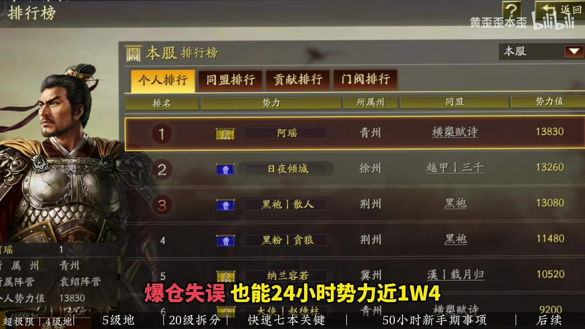

24시간 시점 서버 개인 랭킹 1위, 세력 13,830. 폭창 실수가 있었는데도 1.4만에 가깝다.

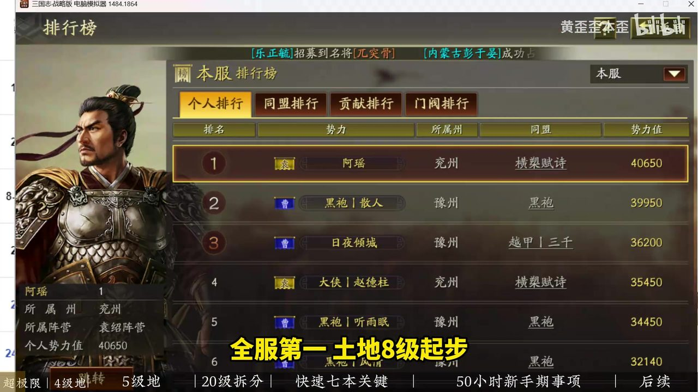

금요일 인도 시점 세력 40,650, 서버 1위. 관문이 열리지 않은 서버에서 4일 만에 3만을 넘겼다.

## 2. 세팅

### 2.1 주력 (노하진)

| 장수 | 고유 전법 | 20레벨 전 | 20레벨 후 (전보 1:56) | 가점 |
|---|---|---|---|---|
| SP노식 (주장, 궁S) | 국지정간 | 잠룡진 | 잠룡진 + 기세등등 | 화면에 없음 |
| 하후연 (궁S) | 장수의 속도 | 맨몸의 혈전 ↔ 최봉단인 | 최봉단인 + 맨몸의 혈전 | 화면에 없음 |
| 진궁 (궁S) | 백계다모(한국명 미확인) | 무당비군 | 무당비군 + (가려짐) | 화면에 없음 |

- 하후연은 전투마다 맨몸의 혈전과 최봉단인을 바꿔 들었다. 5·11·13레벨 전보는 맨몸의 혈전, 6·8·16레벨 이후 전보는 최봉단인이다.
- 세 장수 모두 만홍(진급 5단계)이다.

### 2.2 선공(碰瓷) 부대

| 부대 | 구성 (병력 1) | 전법 | 용도 |
|---|---|---|---|
| 혼란류 | 여몽(주장) + 가후 | 여몽 백의도강(고유)·백마의종 / 가후 신기막측(고유)·뒤섞인 위서 | 5토·6토 다회 선공 |
| 속공류 | 능통(주장) + 손상향 | 능통 국사장풍(고유)·호표기 / 손상향 궁요희(고유)·맨몸의 혈전 | 4토·5토 선공 |
| 장양류 | 장양(주장) + 황월영 | 장양 절행승총(고유)·문무 겸비 / 황월영 공신(고유)·봉시진 | 4토·5토·6토 선공 |
| 6토용 3인 | 가후 + 여몽 + 사사(死士) | 가후 신기막측·뒤섞인 위서 / 여몽 백의도강·백마의종 / 사사 용무·삼세진 | 6토 선공 |

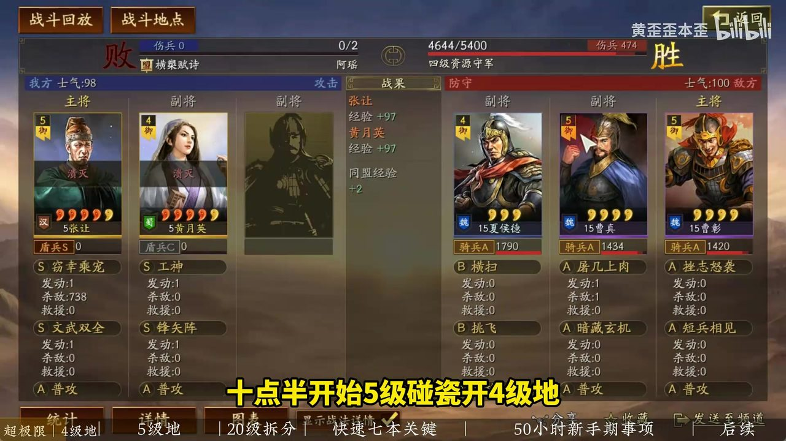

10시 30분, 5레벨 장양·황월영(병력 1)으로 4토 조창 기병을 선공한다.

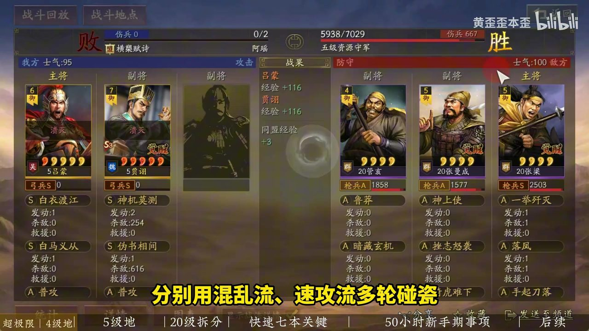

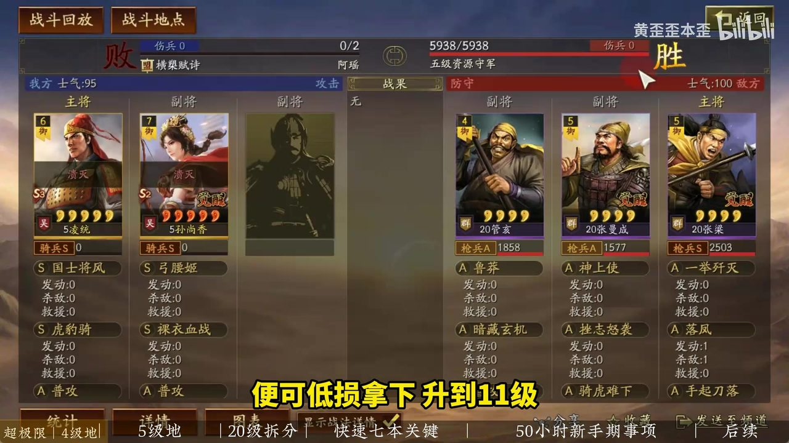

5토 장량 창병에 혼란류(여몽·가후)와 속공류(능통·손상향)를 번갈아 넣어 여러 번 깎는다.

### 2.3 후반 주력 (7본 이후)

| 시점 | 장수 | 전법 |
|---|---|---|
| 33~42레벨 | SP노식 / 태사자 / 진궁 | 국지정간·무당비군·잠룡진 / 신사(고유)·유리한 기회·최봉단인 / 백계다모·절계절모·임기제승 |
| 45레벨 (9토) | SP노식 / 주유 / 제갈량 | 국지정간·잠룡진·초선차전 / 신화계(고유)·혼비백산·맹렬한 불길 / 신기묘산(고유)·무당비군·중지성성 |
| 3군 요희 (10토) | 장료 / 곽가 / 왕원희 | 함진돌습(고유)·유리한 기회·최봉단인 / 십승십패(고유)·절충어모·솔선수범 / (고유)·호표기·정·봉시진 |

- 7본 뒤 하후연이 태사자로 바뀐다. 33레벨부터 노식이 무당비군을 들고 진궁은 절계절모·임기제승을 든다.
- 계정 주인이 원한 최종 덱은 도독궁이다. 7일간 SP노식·주유·제갈량으로 땅을 먹은 뒤 도독궁으로 바꿨다.

## 3. 24시간 "초극한" 타임라인

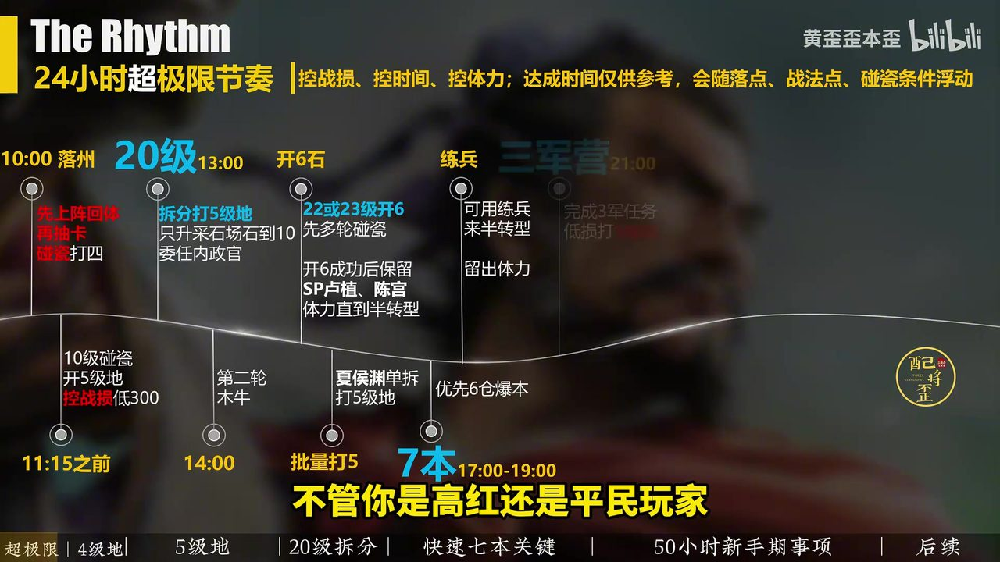

영상의 타임라인 도표를 옮겼다. 시간은 참고값이고 자리·전법·선공 조건에 따라 바뀐다.

| 시각 | 단계 | 할 일 |
|---|---|---|
| 10:00 착지 | 시작 | 개척 부대를 먼저 출전시켜 체력을 받는다. 그다음 뽑기를 한다. 선공으로 4토를 친다 |
| 11:15 전 | 10레벨 | 선공으로 5토를 연다. 5토당 손실 300 이하로 통제한다 |
| 13:00 | 20레벨 | 분할해서 5토를 친다. 채석장만 10레벨로 올린다. 내정관을 임명한다 |
| 14:00 | 2차 목우유마 | 하후연 단독 분할로 5토를 친다 |
| 5토 대량 | 22~23레벨 | 6토 석재를 연다. 먼저 여러 번 선공한다. 6토 성공 뒤 SP노식·진궁 체력은 반전환 때까지 아낀다 |
| 17:00~19:00 | 7본 | 6창고 폭창을 우선한다 |
| 연병 | | 연병으로 반전환한다. 체력을 남긴다 |
| 21:00 | 3군영 | 3군영 임무를 끝낸다. 저손실로 친다 |

- 정상 진행이면 첫날 17~19시에 6창고로 7본, 21시쯤 3군영이다.
- 이번 계정은 녹화 중 실수로 19:24 7본, 23:41 3군영이었다(아래 9절).

## 4. 4토 (5~9레벨)

| 레벨 | 상대 (4토, 병력 3,000×3) | 선공 후 수비군 | 아군 (전→후) | 부상 | 결과 | 경험치 |
|---|---|---|---|---|---|---|
| 5 | 조창 기병 (하후덕·조진·조창) | 3,848 | 1,500 → 1,354 | 68 | 승, 주장 조창 격파 | 1,592 → 6레벨 |
| 6 | 반장 창병 (주거·반장·여대) | 4,432 | 1,800 → 1,637 | 26 | 승, 전멸 | 4,042 → 8레벨 |
| 8 | 상총 기병 (상총·부융·조통) | 4,783 | 2,400 → 2,243 | 75 | 승, 주장 조통 격파 | 3,005 → 9레벨 |

- PK1은 수비군이 약해 4,000 이하로 깎으면 쳤다. PK3 이후 시즌은 3,000 이하를 권한다.
- 상성 병종이 아니어도 고른다. 두 번째 땅은 창병(반장)이었다.
- 10레벨이 되면 선공으로 5토를 연다.

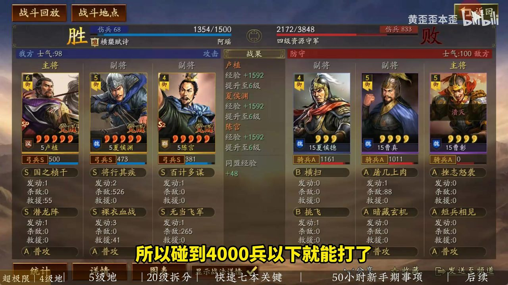

5레벨, 조창 기병. 수비군 3,848에서 시작해 부상 68로 이겼다.

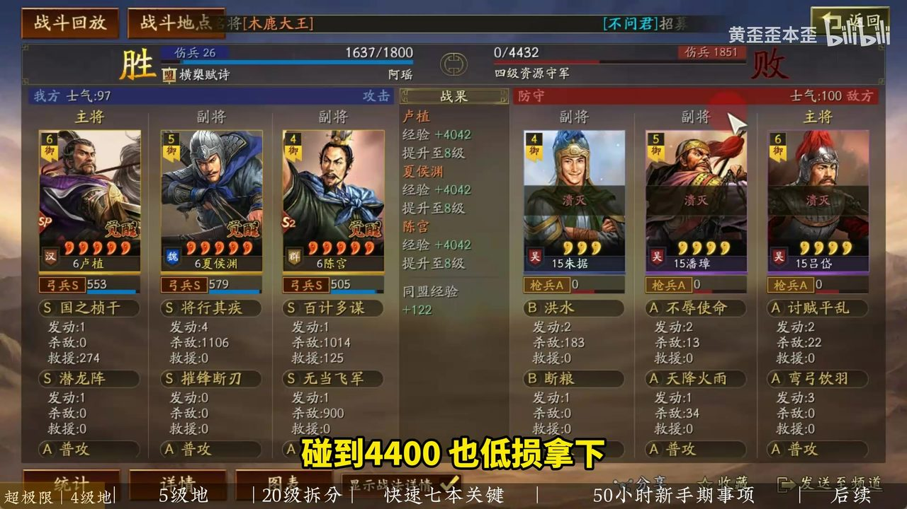

6레벨, 반장 창병. 선공으로 4,432까지 깎고 들어가 전멸시켰다. 8레벨이 됐다.

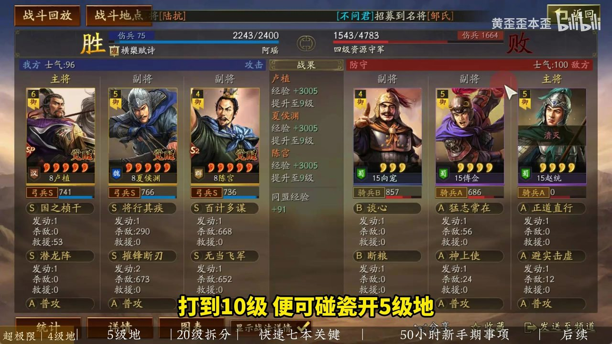

8레벨, 상총 기병. 9레벨이 됐다.

## 5. 5토 (10~20레벨)

### 5.1 원칙

- **15레벨 전에는 창병만 친다.** 20레벨 전 5토 우선순위는 **장량 > 반장 > 조진 > 이각**이다.
- 15레벨 이후에는 능조 기병, 곽사 기병도 친다.
- **손실 기준은 5토 한 장당 평균 300 이하**다. 이 기준이 7본 폭창 전략을 좌우한다.
- 선공으로 장량 창병을 6,000 이하로 깎으면 10~11레벨에 저손실로 잡는다.

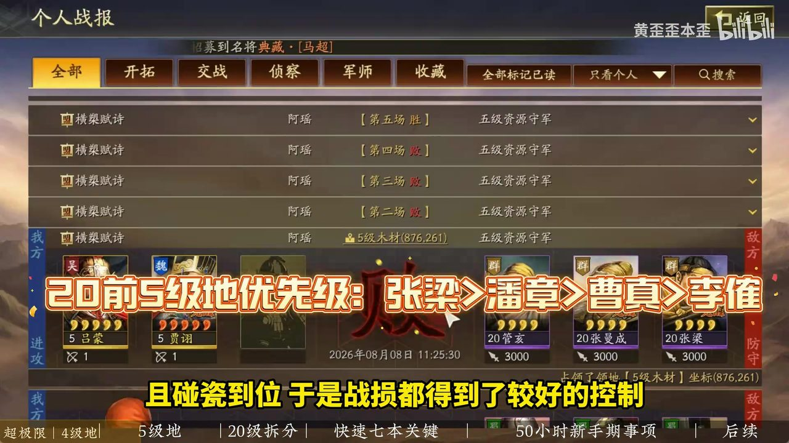

### 5.2 전보

| 레벨 | 상대 (5토, 병력 3,000×3) | 선공 후 수비군 | 아군 (전→후) | 부상 | 결과 | 경험치 |
|---|---|---|---|---|---|---|
| 11 | 장량 창병 (관해·장만성·장량) | 5,794 (선공 6회) | 3,300 → 3,144 | 22 | 승, 주장 격파 | 6,066 |
| 11 | 조홍 창병 (가규·문빙·조홍) | 5,571 | 3,300 → 3,046 | 84 | 승, 주장 격파 | 6,672 → 12레벨 |
| 13 | 장량 창병 | 5,876 | 3,900 → 3,771 | 14 | 승, 전멸 | 7,835 |
| 16 | 능조 기병 (반장·주환·능조) | 7,109 | 4,800 → 4,496 | 93 | 승, 주장 격파 | 8,659 → 17레벨 |
| 18 | 장량 창병 | 8,276 | 5,400 → 5,106 | 79 | 승, 전멸 | 11,051 |
| 19 | 조홍 창병 | 7,315 | 5,700 → 5,561 | 0 | 승, 전멸 | 9,754 |
| 19 | 조홍 창병 | 7,039 | 5,700 → 5,619 | 22 | 승, 주장 격파 | 7,823 → 20레벨 |

- 11:44에 15레벨로 이각 기병(이각·곽사·서영)도 쳤다(병력 1,500씩).
- 12시에 18레벨이 되자 체력이 떨어졌다. 13:30까지 기다렸다가 5토를 더 쳐 20레벨을 만들었다. PK1은 땅 경험치가 적어 더 많이 쳐야 했다.

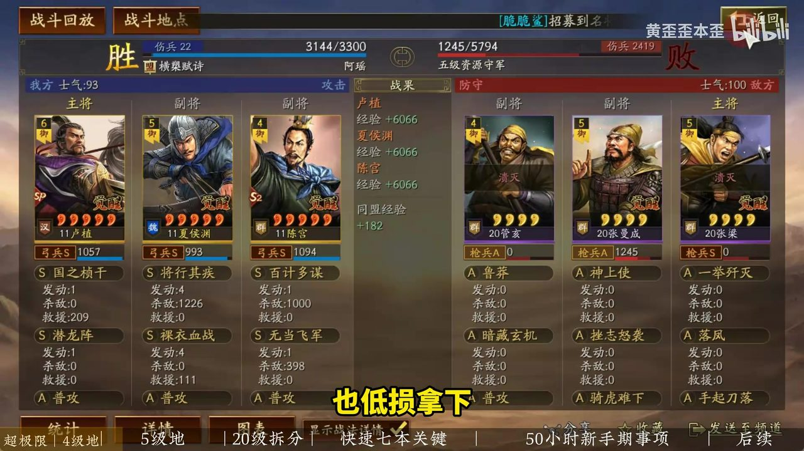

11레벨, 장량 창병. 선공 6회로 5,794까지 깎았다. 부상 22.

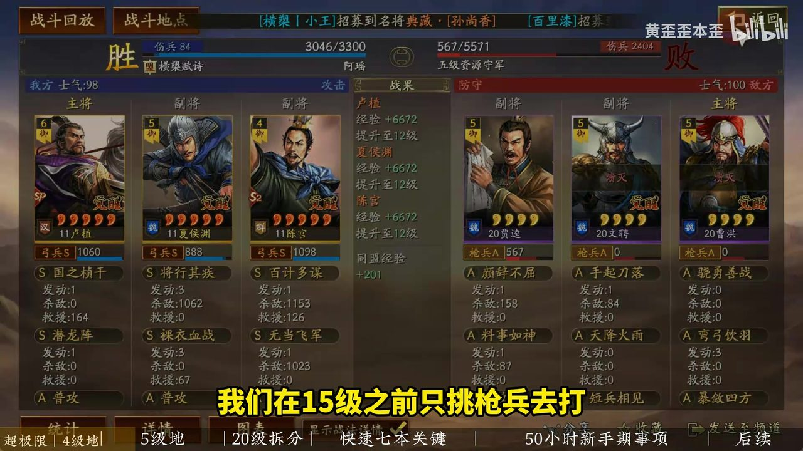

11레벨, 조홍 창병. 5,571에서 시작해 부상 84. 12레벨이 됐다.

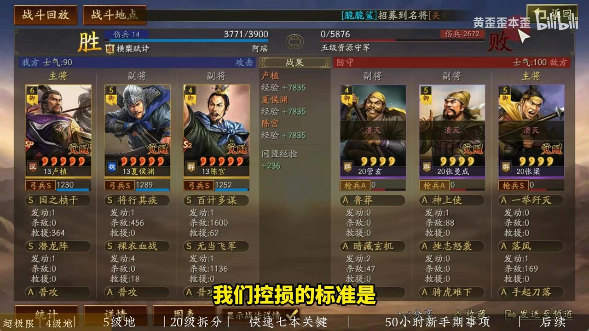

13레벨, 장량 창병 전멸. 부상 14.

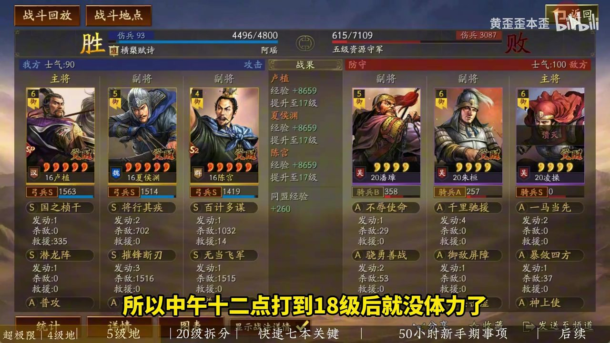

16레벨, 능조 기병. 15레벨 뒤에는 기병도 친다. 하후연은 최봉단인이다.

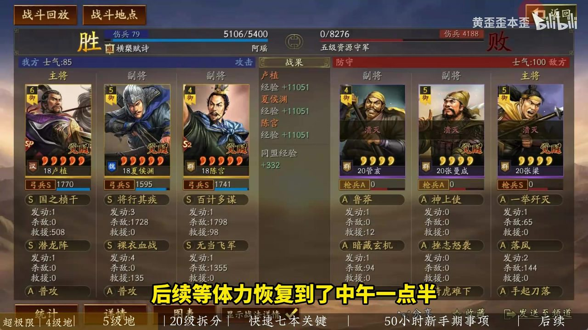

18레벨, 장량 창병. 8,276까지만 깎고 들어가 전멸시켰다.

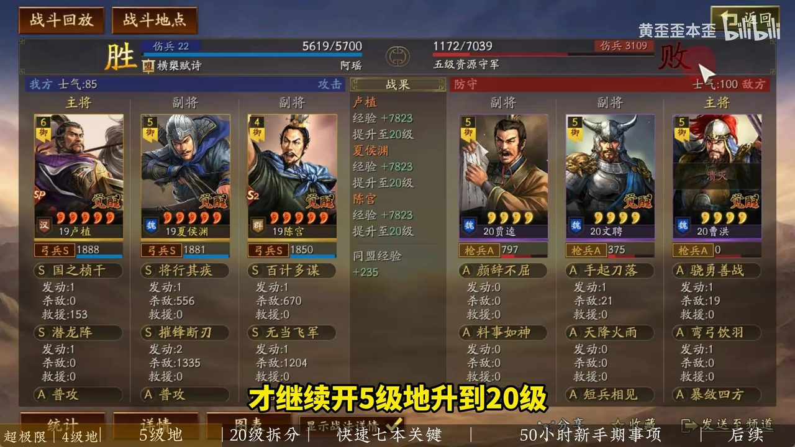

19레벨, 조홍 창병. 이 전투로 20레벨이 됐다.

## 6. 6토 (20레벨, 14:24)

PK1은 수비군이 약하고 체력이 부족해 20레벨에 바로 6토를 열었다. 영상은 "PK3 이후에는 이렇게 일찍 치지 말라"고 못 박았다.

| 상대 (6토, 30레벨, 병력 5,000×3) | 선공 후 수비군 | 아군 (전→후) | 부상 | 결과 | 경험치 |
|---|---|---|---|---|---|
| 장연 창병 (장연·관해·장만성) | 12,530 | 6,000 → 5,953 | 0 | 승, 주장 격파 | 19,362 |
| 황권 궁병 (요화·마속·황권) | 15,000 (선공 없음) | 5,953 → 5,566 | 100 | 승, 주장 격파 | 28,250 → 21레벨 |

- 첫 6토는 가후·여몽·사사 3인 선공 2회와 장양·황월영 선공 1회로 15,000을 12,530까지 깎았다. 주력은 거의 무손실로 잡았다.
- 두 번째 6토는 황권 궁병을 만나 약 300을 잃었다. 그래도 안정적으로 잡아 둔전이 안정됐다.

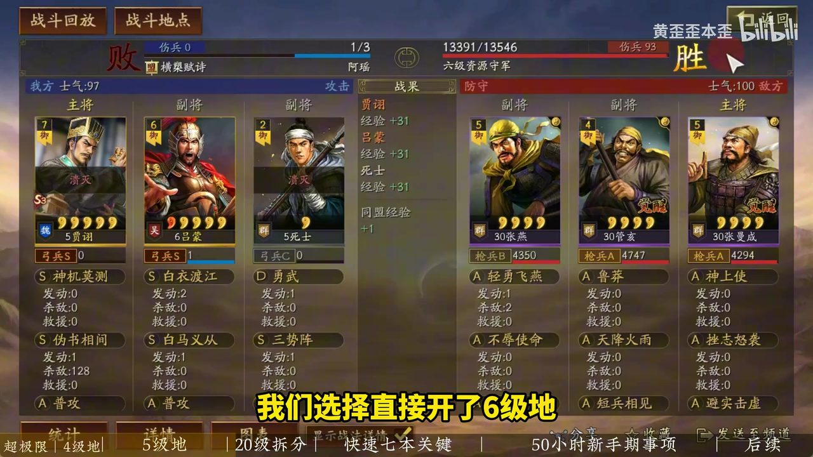

가후·여몽·사사(병력 1)로 6토 장연 창병을 선공한다.

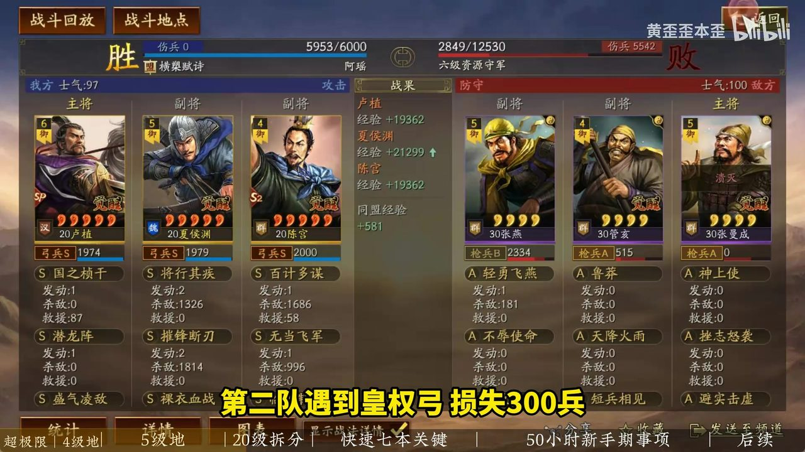

20레벨, 6토 장연 창병. 12,530에서 시작해 부상 0.

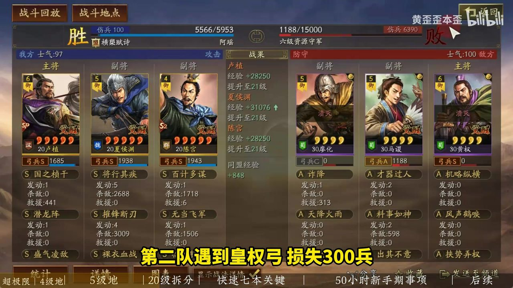

20레벨, 6토 황권 궁병. 선공 없이 15,000을 쳐서 약 300을 잃었다. 21레벨이 됐다.

## 7. 20레벨 분할 (2+1)

체력을 아끼면서 5토를 더 많이 치기 위해 두 부대로 나눈다.

| 부대 | 장수 (레벨) | 전법 | 상대 (5토) | 아군 (전→후) | 부상 | 결과 |
|---|---|---|---|---|---|---|
| 궁병 | SP노식(21)·진궁(21)·황월영(10) | 국지정간·맹렬한 불길·기세등등 / 백계다모·절계절모·임기제승 / 공신·백마의종 | 장흠 궁병 (서성·한당·장흠) | 4,201 → 4,187 | 0 | 승, 전멸 |
| 기병 | 하후연(21)·태사자(5)·황월영(7) | 장수의 속도·맨몸의 혈전·적진 습격 / 신사·호표기 / 공신·봉시진 | 조창 방패병 (장패·곽회·조창) | 2,102 → 1,616 | 169 | 승, 전멸 |
| 기병 | 하후연(22)·태사자(9)·황월영(11) | 위와 같음 | 마량 방패병 (요화·주창·마량) | 2,202 → 2,202 | 0 | 승, 주장 격파 |

- 기병 부대도 선공을 붙이면 저손실로 5토를 잡는다.
- 태사자가 분할 경험치를 먹어 7본 뒤 하후연을 바로 대체한다.
- 레벨이 오른 황월영은 뒤에 병기(공성) 장수로 쓴다.
- 맹렬한 불길은 风助火势의 한국명 추정이다(1턴 준비 후 적 전체 화공·연소, 설명 일치).

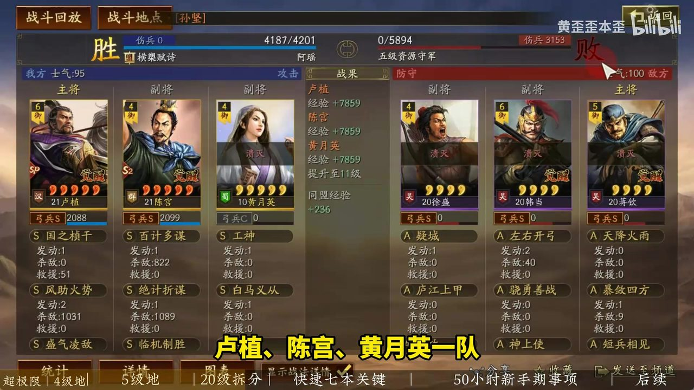

SP노식·진궁·황월영 궁병 부대, 5토 장흠 궁병 전멸.

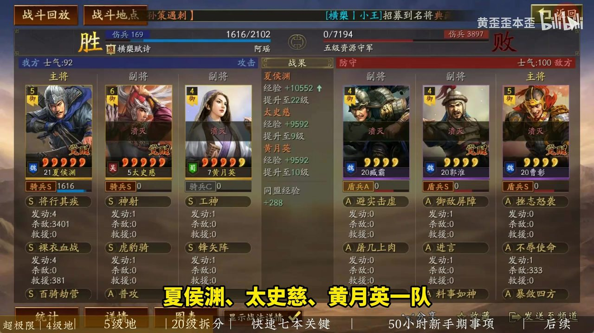

하후연·태사자·황월영 기병 부대, 5토 조창 방패병 전멸. 태사자가 5레벨에서 9레벨이 됐다.

## 8. 자원 비율과 내정

| 자원 | 비율 | 이유 |
|---|---|---|
| 목재 | 2.5 | 징병과 과학기술에 쓴다. 5토 둔전은 손해라 생산량으로 쌓는다 |
| 철 | 2.5 | 목재와 같다. 목 생산량 ≈ 철 생산량 |
| 석재 | 0.8 | 소모는 크지만 높은 과학기술에 필요하다. 6토 석재를 연 뒤 둔전으로 채운다 |
| 식량 | 0.3 | 공훈 상점에서 산다. 5토 식량을 많이 치면 세력은 올라도 폭창에 쓸모없고 넘친다 |

- 식량은 "식량 5,000" 임무를 넘긴 뒤 **토지 변경 문서**(금주 20 또는 100)로 다른 자원 땅으로 바꾼다.
- 내정관은 **장소**다. 전법 포인트를 다 찍은 장소는 시간당 2,000을 더 만든다. 10시간이면 2만이다.

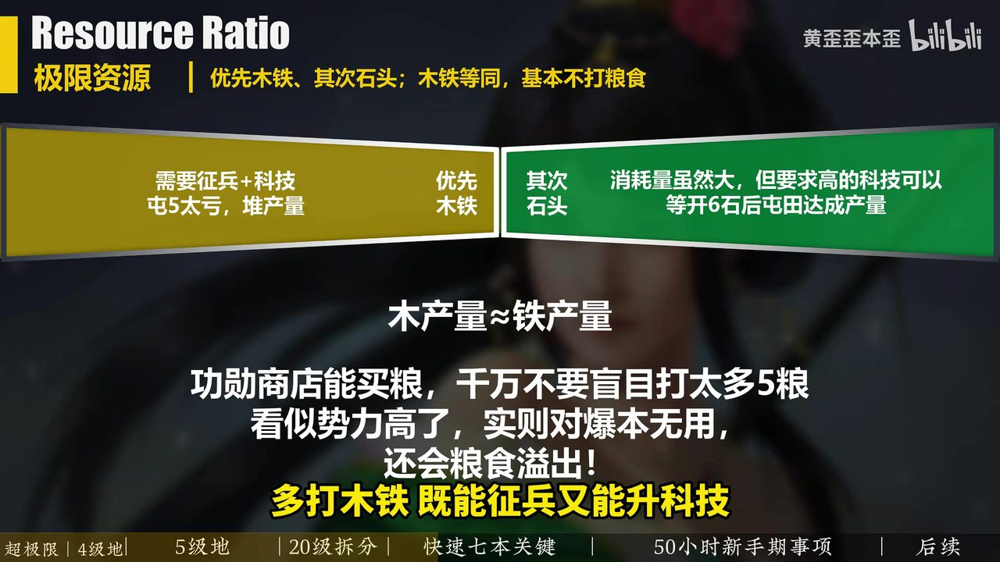

## 9. 7본 폭창 (이번 계정의 실수 포함)

- **6창고 폭창**: 석재 14.1만이 필요하다. 8·9·10장 임무 보상을 받지 않고 모아 둔다.
- 녹화 담당자가 녹화 프로그램에 익숙하지 않아 **6레벨 군왕전 올리는 것을 잊었다.** 폭창에 실패했다.
- 그래서 8창고까지 올리고 **4레벨 징병소로 7본을 폭창**했다. 시간을 많이 잃었다.
- PK1은 경험치가 적고 땅 보충이 느려 19:24에 7본, 23:41에 7본 3군영이 됐다. 정상은 17~19시 7본, 21시 3군영이다.
- 영상은 실수 장면을 일부러 남겼다. "한 번 실수해도 뒤에서 따라잡는다"는 것이 교육 목적이라고 했다.

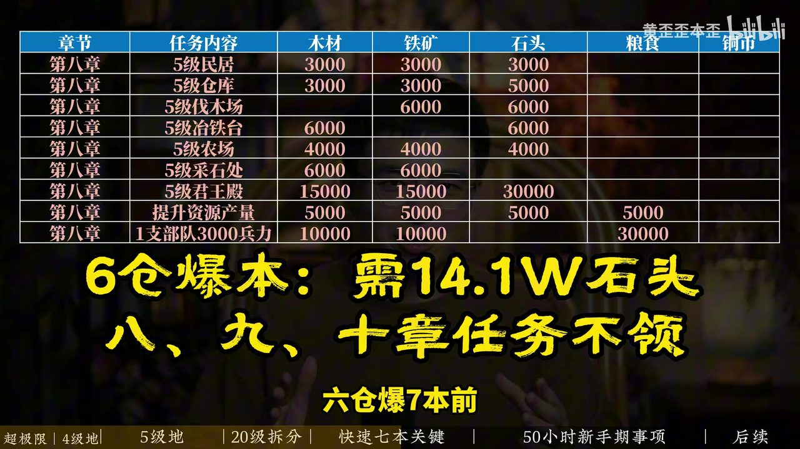

8장 임무 보상표. 6창고 폭창에는 석재 14.1만이 필요하고 8·9·10장 임무는 받지 않는다.

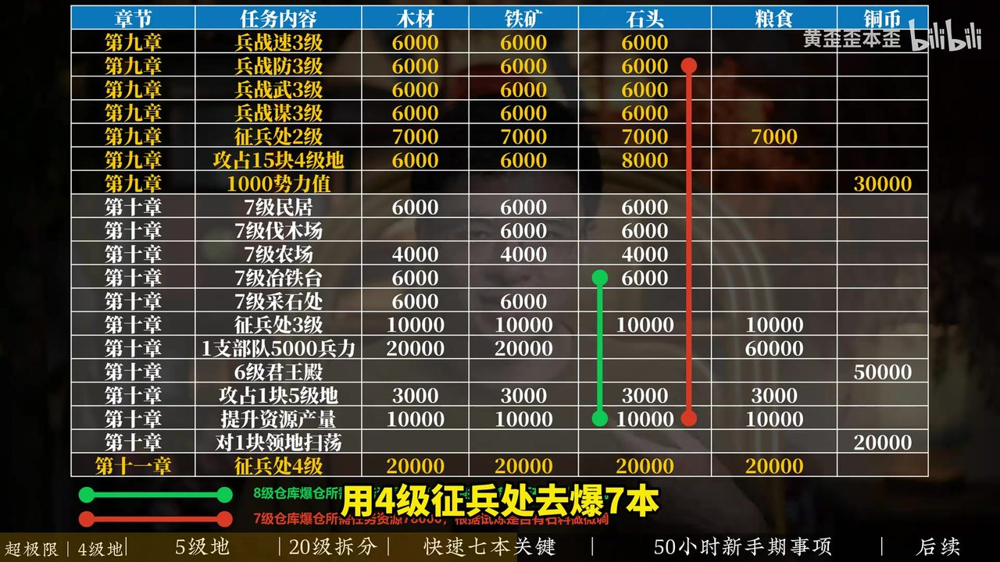

9·10장 임무 보상표. 빨간 선은 7창고 폭창, 초록 선은 8창고 폭창에 쓰는 임무다. 4레벨 징병소로 7본을 폭창했다.

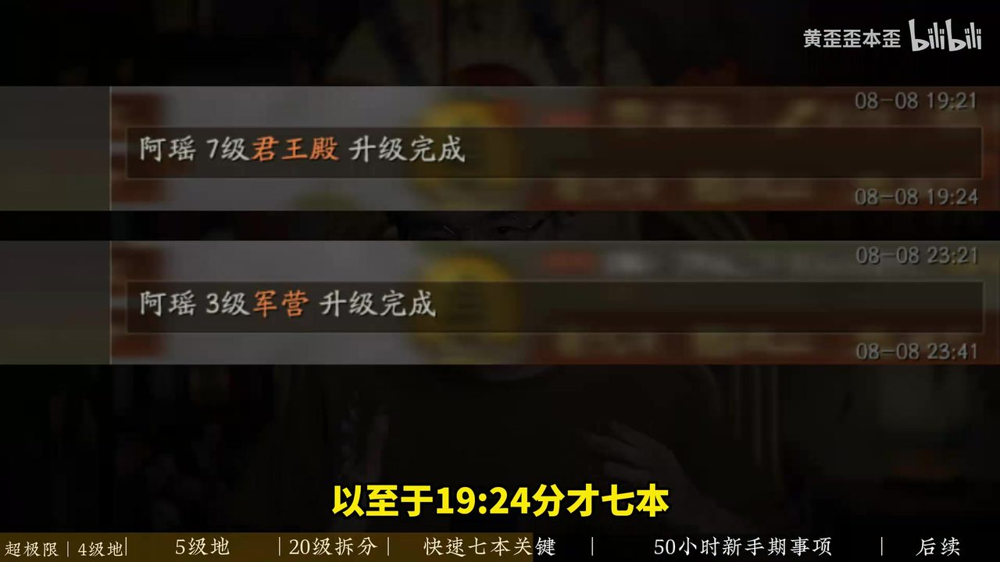

08-08 19:24 7레벨 군왕전, 23:41 3레벨 군영.

## 10. 7토·8토와 24시간 결과

| 시각 | 레벨 | 상대 | 아군 (전→후) | 부상 | 결과 | 경험치 |
|---|---|---|---|---|---|---|
| 08-09 06:48 | 33 (노식·태사자·진궁) | 7토 허저 창병 (곽회·조홍·허저, 35레벨, 17,597) | 12,300 → 12,120 | 22 | 승, 전멸 | 48,411 (태사자 53,252) |
| 08-09 | 33 | 7토 이유 기병 (곽사·이각·이유, 35레벨, 21,000) | 12,120 → 11,316 | 144 | 승, 전멸 | 57,349 |
| 08-09 09:30 | 38 | 8토 동탁 부대 (곽사·여포·동탁, 40레벨, 27,000) | 4,638/4,586/3,257 | - | 승 | - |

- 7본 3군영 보정을 받아 새벽 6시 48분에 첫 7토 석재를 잡았다.
- 24시간 시점(08-09 10:00) 세력 13,830으로 서버 1위다. 부대 레벨 38/39/38, 총병력 13,824/14,500, 통솔 16/16이다.

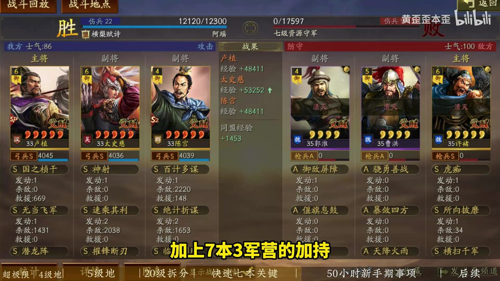

33레벨 SP노식·태사자·진궁. 노식 국지정간·무당비군·잠룡진, 태사자 신사·유리한 기회·최봉단인, 진궁 백계다모·절계절모·임기제승.

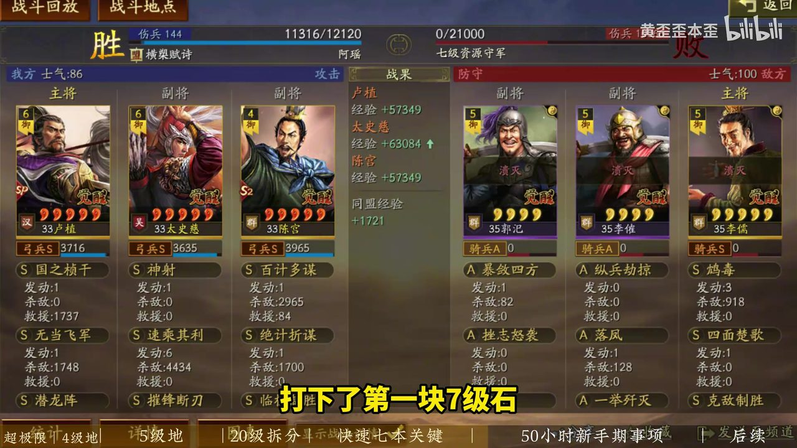

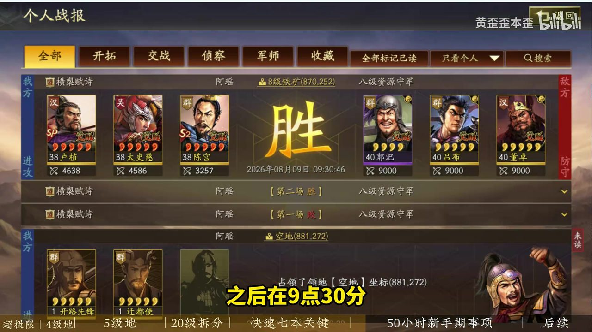

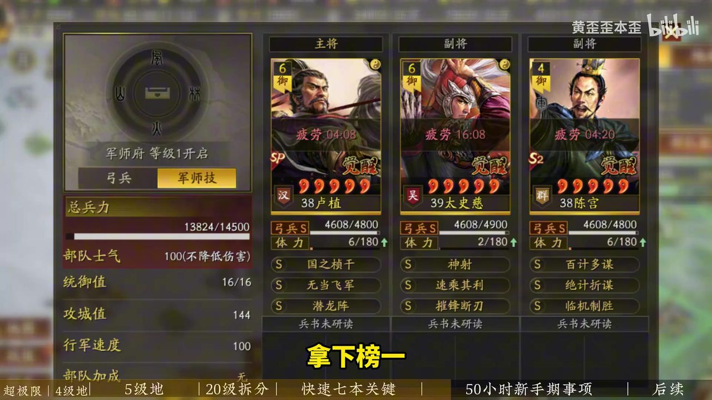

## 11. 50시간까지: 연병과 전환

- 7본 뒤에는 연병을 병행한다. 계정 주인은 처음에 도독궁을 원했다.
- 개척기에 도독궁을 연병하면 진도가 늦어진다. 그래서 상의 끝에 **SP노식·주유·제갈량**으로 먼저 땅을 먹고, 7일 뒤 도독궁으로 바꾸기로 했다. PK4 시즌이면 바로 한궁으로 바꾸면 되는 문제다.
- 7본 뒤 6·7·8토를 계속 먹었다. 17시쯤 20레벨 채석장을 완성했다. 둔전 보너스로 8토 석재를 둘러쌌다.
- 일요일 밤 24시쯤(08-10 00:44) 8본. 월요일 06시 10레벨 군영. 09:47 **19통솔 전환** 완료.
- **50시간 세력 19,070**, 서버 1위. 이 계정은 영조 농업 50이 없어 땅 상한이 2칸 적다. 있었으면 2만을 넘겼을 것이라고 했다.

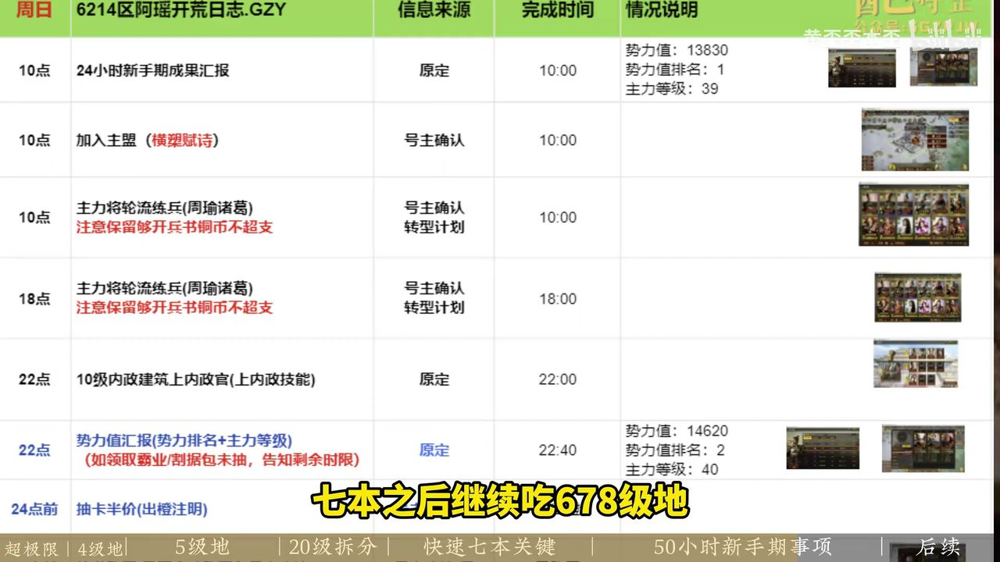

일요일 일지. 10시 24시간 성과 보고(세력 13,830, 1위, 주력 39레벨), 주력 교대 연병(주유·제갈), 22시 10레벨 내정 건물에 내정관, 22:40 세력 14,620.

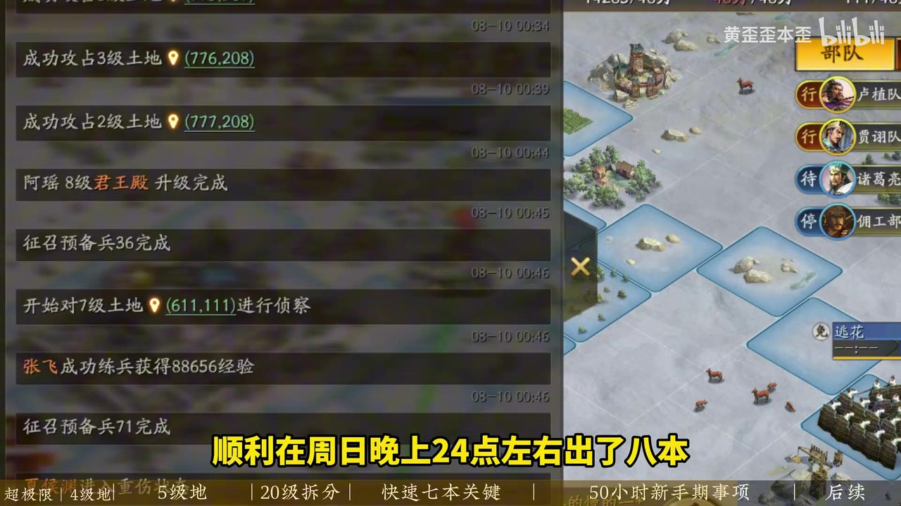

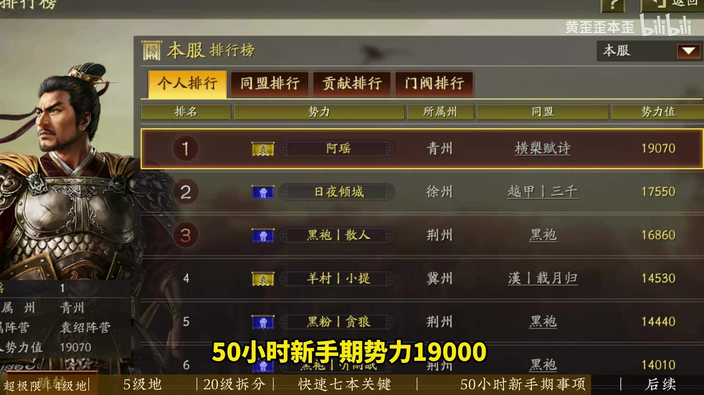

50시간 세력 19,070, 서버 1위.

## 12. 그 후 (3~7일)

| 시점 | 내용 |
|---|---|
| 화요일 | 주력 42레벨, 2군 36레벨, 세력 27,800 |
| 4일째 | 세력 3만 돌파 (관문 미개방 서버) |
| 7일째 | SP노식·주유·제갈량 45레벨이 9토, 3군 요희(장료·곽가·왕원희 42레벨)가 10토를 친다. 레벨 경험치를 치환한다 |
| 금요일 인도 | 3개 부대 45레벨, 세력 40,650, 서버 1위. 이후 도독궁으로 전환 |

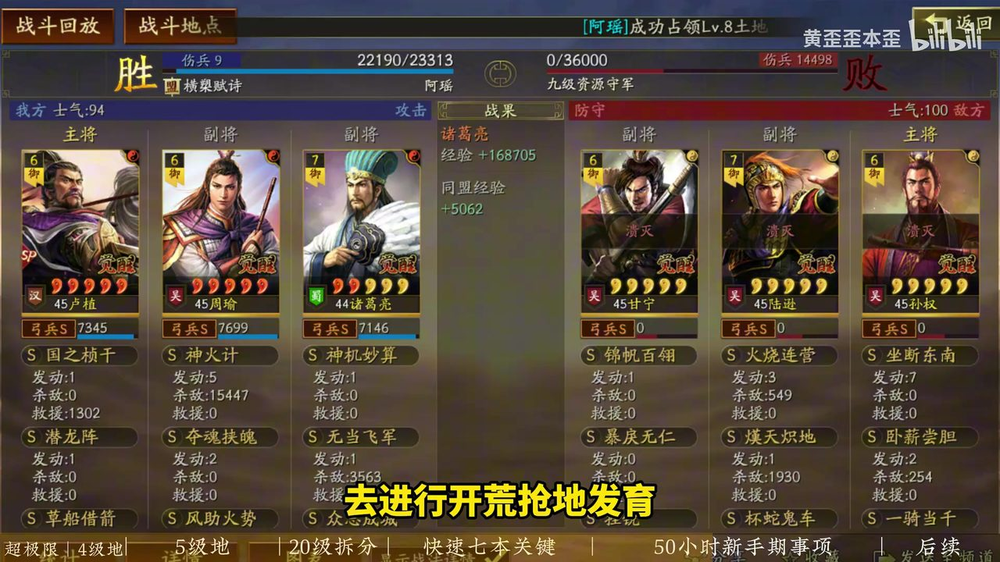

45레벨 SP노식·주유·제갈량이 9토 손권 궁병(감녕·육손·손권, 45레벨 36,000)을 전멸시켰다. 아군 23,313 → 22,190, 부상 9.

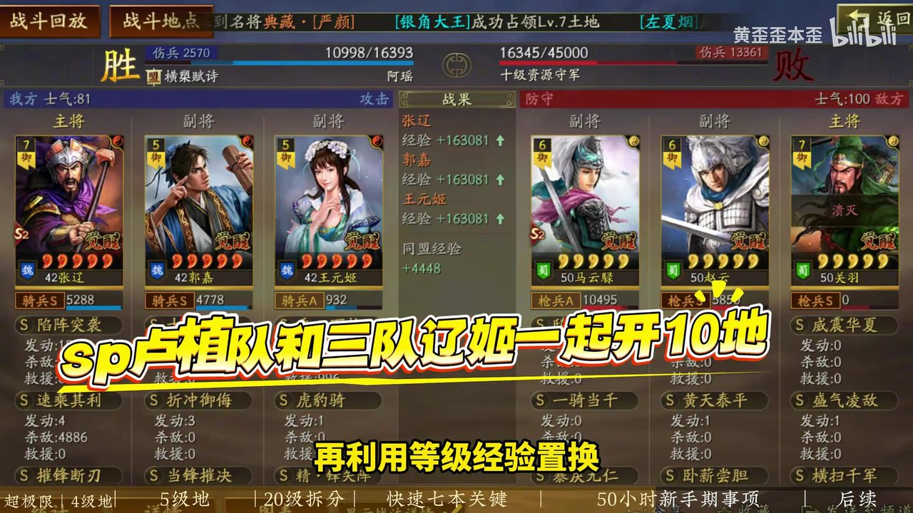

42레벨 요희(장료·곽가·왕원희)가 10토 관우 창병(마운록·조운·관우, 50레벨 45,000)을 잡았다. 아군 16,393 → 10,998.

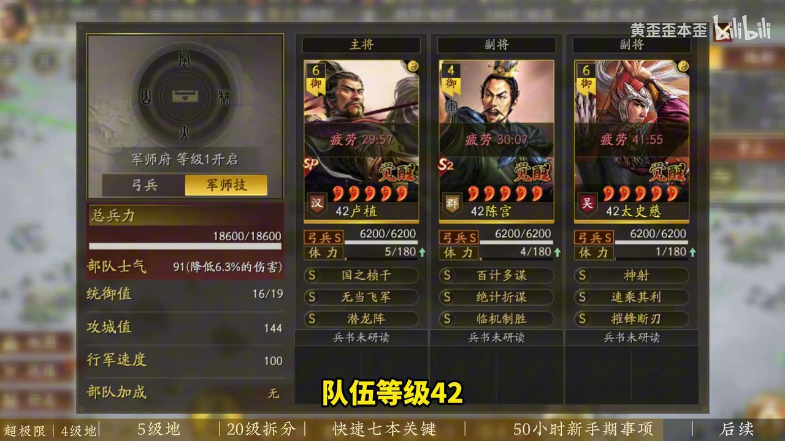

## 13. 업체 기준표 (참고)

영상 중간에 업체의 개척 등급표가 나온다. 세력 목표의 감을 잡는 데만 참고한다.

| 항목 | 보통 개척 | 극한 개척 | 초극한 개척 |
|---|---|---|---|
| 대상 | 모든 플레이어 | 고홍·만홍, 진도 요구 | 만홍·만전법, 선공 부대 완비 |
| 담당자당 계정 수 | 5 | 2~3 | 1~2 |
| 24시간 세력 | 고홍 9K+, 중홍 8~9K, 저홍 6~7K | 고홍 1.2만+, 중홍 1만~1.1만, 저홍 9K+ | 전법 포인트 9만 필요, 1.3만+ 보장, 보통 1.4만 |
| 50시간 | 세력 1.2~1.3만, 통솔 17~19 | 세력 1.4~1.7만, 통솔 19 | 1.7만+, 농업·공성 많으면 2만 |
| 전환 | 16통솔 전환 또는 17통솔 보장 | 50시간 안에 18~19통솔 | 전환 포함 |
| 2군 | 2만 상품은 2군 육성 | 2만·2.5만 상품은 2군 완성 | 전법 포인트 충분하면 7일 3군 45레벨 |

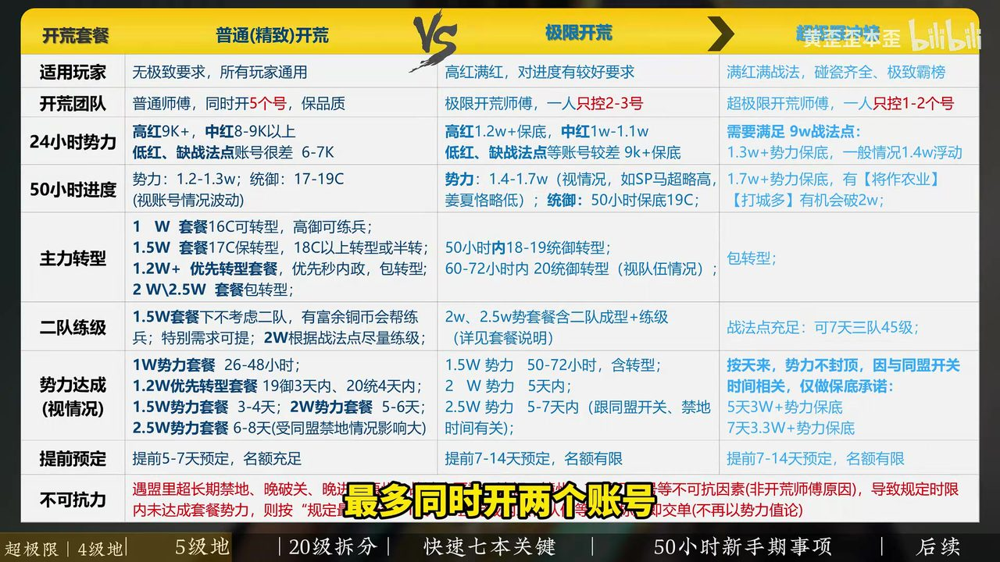

## 14. 확인 못 한 것

- 세 장수의 가점(속성 분배)은 화면에 나오지 않았다.
- 진궁 고유 백계다모, 절계절모, 태사자 고유 신사, 황월영 고유 공신, 주유 고유 신화계, 제갈량 고유 신기묘산의 한국 공식명은 확인하지 못했다. 한자음으로 적었다.
- 风助火势=맹렬한 불길은 조합기 설명과 맞춘 추정이다.
- 10레벨 첫 5토 전보, 이각 기병 15레벨 전보의 수치는 영상에 상세 화면이 없다.
- 영상의 음성은 받아 적지 못했다. 화면 자막과 전보만 썼다.
- PK1 시즌이라 5토 수비군이 20레벨이다. 지금 한국 시즌(27레벨)보다 쉬우므로 진입 레벨은 그대로 쓸 수 없다.

## Sources

- [Bilibili: SP卢植"超极限"开荒：这教程真怕引起内卷啊 (黄歪歪本歪, 2026-08-17)](https://www.bilibili.com/video/BV15Jbe6bEhT/)
- [smlotto S28 조합기 (전법 한국명 대조)](http://smlotto.com/samjeon_s28.html)
