# 노하제(SP노식·하후연·제갈각) 개척 공략

- 작성일: 2026-11-05
- 기준: 중국 百家号(秋石小军师·三战之光青云·三战林冲), 知乎, 妖精团队 백서와 한국 디시 송해리 님 PDF를 대조해 정리. 전법·장수 이름은 한국 서버 표기로 옮김.
- 전보 선별: 수비군 레벨이 지금 시즌과 같은 전보만 실었다(5토 27레벨, 6토 30레벨, 7토 35레벨). 아래 전보 화면은 모두 秋石小军师 2026-06-30 글에서 가져왔고, 번체 클라이언트(국제판 계정)다.
- 용어: **선공(碰瓷, 폭탄)** = 소수 병력 부대로 먼저 쳐서 수비군 병력을 깎는 것. **2+1** = 병력을 가진 주력 둘 + 1병 보조 하나. **1+2** = 주력 하나 + 1병 보조 둘. **노강제** = 7본 뒤 하후연 자리에 강유를 넣은 SP노식·강유·제갈각.
- 손실 수치는 전보 화면의 표시 병력 감소이며, 선공 비용은 포함하지 않는다.
- 같은 SP노식 궁병 계열인 노하진 자료는 [노하진_개척정보.md](노하진_개척정보.md)에 따로 있다.

## 0. 결론 요약

| 항목 | 결론 |
|---|---|
| 위치 | 진궁이 없거나 2홍 이하일 때 노하진을 대신하는 1순위 덱 (三战之光 9/1, 知乎 6/19) |
| 장단점 | 제갈각은 궁병 적성 A에 딜이 약해 손실이 노하진보다 크다. 대신 7본 뒤 무손실로 한궁에 이어진다 |
| 세팅 뼈대 | 20레벨 전: 노식 잠룡진 / 하후연 맨몸의 혈전 / 제갈각 임기제승. 20레벨 후: 노식 +무당비군 / 하후연 +최봉단인 / 제갈각 +도심혹적 |
| 4토 | 만홍 5~8, 백판 9~10 (일반 기준). 8레벨 무렵부터 3,500~4,000까지 선공 |
| 5토 | 만홍 10~13, 백판 16~18 (일반 기준). 6,000 이하로 선공. 13레벨 미만 진입 금지 |
| 6토 | 23레벨부터 (秋石). 첫 6토는 반드시 선공. 25~29레벨 실전 10전 8승 2무 |
| 7토 | 만홍 33레벨+군영 10급 (일반 기준). 노강제 34~35레벨로 조운창 승리, 장각방패 무승부 |
| 분할 | 21레벨부터. 노식+제갈각 2+1은 창병·기병 5토, 하후연 1+2는 진교방패 5토 |
| 24시간 세력 | 12,690 (秋石 6/30, 7토 장각에 고손실이 겹쳐 아쉬운 결과라고 적음) |

## 1. 전법 세팅

### 1.1 세팅표 (20레벨 전 / 후)

| 장수 | 가점 | 20레벨 전 | 20레벨 후 | 비고 |
|---|---|---|---|---|
| SP노식 (주장) | 전통 | 잠룡진 | 잠룡진 + 무당비군 | 무당비군을 들면 특기는 灵动 대신 援助 (한국명 미확인) |
| 하후연 | 전무 + 속도 2 | 맨몸의 혈전 | 맨몸의 혈전 + 최봉단인 | 속도 2는 야지 장량보다 먼저 움직이기 위함 |
| 제갈각 | 전지 (9/1) 또는 전통 (8/30) | 임기제승 | 임기제승 + 도심혹적 | 특기 灵动 |

- **근거**: 秋石 6/30, 三战之光青云 8/30·9/1이 20레벨 후 세팅을 똑같이 적었다. 제갈각 가점만 三战之光 8/30 글은 전통, 9/1 글은 전지로 다르다.
- **고유 전법**: SP노식 국지정간, 하후연 장수의 속도, 제갈각 挥兵谋胜(한국명 미확인).
- **노하진과 다른 점**: 노하진 배치 B처럼 노식이 무당비군을 맡고, 제갈각은 임기제승·도심혹적으로 딜과 제어를 보탠다. 세 장수 진영이 모두 달라(노식 한 또는 군, 하후연 위, 제갈각 오) 잠룡진을 그대로 쓸 수 있다.
- **병서**: 노하제 전용 병서 자료는 찾지 못했다. 노하진 기준으로는 노식 삼군병사·구전·통군, 하후연 일고작기·승리·집예다.

### 1.2 홍도와 쓸 조건

| 출처 | 기준 |
|---|---|
| 三战之光青云 8/31 | 노식 만홍인데 진궁이 없으면 노하제로 시작해 7본에 한궁으로 넘어간다 |
| 三战之光青云 9/1 | 노식 만홍이 전제. 노식까지 낮으면 강하제(강유·하후연·제갈각)처럼 홍도를 덜 타는 덱이 낫다 |
| 知乎 6/19 (跌宕 의견) | 진궁 2홍 이상이면 진궁, 2홍 이하면 제갈각 |
| 知乎 6/19 | 제갈각 딜이 부족해 20레벨 전 무승부가 잦다. 7본 뒤 강유를 연병해 투입해야 한다 |

- **덱 끝까지 쓸 때**: 하후연 3홍 이상이 노하진 기준이다(妖精). 노하제 전용 홍도 기준은 찾지 못했다.
- **처음부터 홍도가 낮을 때**: 三战之光 9/1은 강하제로 개척하다 7본에 강유를 SP노식으로 바꾸는 길을 권한다. 바꾼 뒤 편성이 노하제와 같아져 손실 없이 이어진다고 했다.

### 1.3 7본 이후 전환

| 경로 | 편성 | 전법 | 출처 |
|---|---|---|---|
| 노강제 (16코) | SP노식 · 강유 · 제갈각 | 강유 고유 义胆雄心(한국명 미확인) + 상병벌모. 노식·제갈각은 그대로 | 秋石 6/30 전보 |
| 한궁 연습판 (47~49레벨) | SP조조 · SP노식 · SP초선 | 조조 선등 결사대 + 도원결의 / 노식 강유병제 + 안행진 / 초선 심장약허 + 육력동심 | 三战之光 8/30·8/31 |
| 한궁 통용판 (49레벨부터) | SP조조 · SP노식 · SP초선 | 조조 초선차전 + 도원결의 / 노식 선등 결사대 + 안행진 / 초선 심장약허 + 육력동심 | 三战之光 8/30·8/31 |
| 진궁 없이 계속 | 노식 + 강유·태사자·주유 중 1명 + 제갈각 | 1.1절 20레벨 후 세팅을 그대로 이어 씀 | 三战之光 9/1 |

- 한궁 병서는 세 명 모두 삼군병사·통군·구전이다. 가점은 조조·노식 전통, 초선 전지다.
- 한궁 속도 순서는 노식 1속(속도 +6~10) > 조조 2속 > 초선 끝속이다(三战之光 8/30).
- 육력동심은 이벤트 전법이라 없으면 비슷한 전법으로 대신하라고 적었다.

## 2. 토지별 적정 레벨·선공 기준·추천 수비장수

| 토지 | 진입 레벨 | 노하제 실전 | 선공 기준 | 추천 수비장수 | 피할 수비장수 |
|---|---|---|---|---|---|
| 4토 | 만홍 5~8 / 백판 9~10. 8레벨 미만 진입 금지 (三战之光 8/30, 일반 기준) | 전보 없음 | 8레벨 무렵부터 3,500~4,000까지 | 주환창, 장량창, 능조기, 곽사기 (노식 궁병 공통, 妖精 노하진표) | 황권궁, 진교방패 (혼란 보유, 三战之光) |
| 5토 | 만홍 10~13 / 백판 16~18. 13레벨 미만 진입 금지 (일반 기준) | 24레벨 2+1, 26레벨 1+2, 26~27레벨 노강제 만병 | 14레벨 무렵부터 6,000 이하로 | 장량창 > 반장창 > 조진기 (秋石 6/30) | 방패병 (분할 기병대는 진교방패만 상대) |
| 6토 | 23레벨부터 (秋石 6/30). 일반 기준 만홍 23~25 / 백판 28~30, 25레벨 미만 금지, 군영 3급 이후 권장 | 25~29레벨 10전 8승 2무 | 첫 6토는 반드시 선공. 노하진 기준 1부대 12,000 이하 (林冲) | 창병, 조창기 (秋石 6/30) | 방패병 (三战之光 9/1) |
| 7토 | 만홍 33레벨+군영 10급 / 백판 36레벨+군영 8급. 33레벨 미만 금지 (일반 기준) | 노강제 34~35레벨 1승 1무 | 克制 상대만 친다 | 조운창 등 창병 | 장각방패 ("이 덱은 방패가 정말 힘들다", 秋石) |

- "일반 기준"은 三战之光青云 8/30 글이 지금 시즌 야지 기준으로 정리한 공통 레벨이며, 노하제 전용 수치는 아니다.
- 6토와 7토는 수비군이 두 부대다. 아래 6·7토 표에서 아군 병력이 이어지는 두 줄은 같은 토지의 1·2교전으로 보인다.
- 5토 우선순위는 출처마다 다르다. 秋石은 노식 궁병이 창병을 克制하므로 장량창을 1순위로, 三战之光 8/30 일반 기준은 조진기를 1순위로 꼽았다.

## 3. 20레벨 이하 토지 전보

중국·대만 웹에서 노하제의 20레벨 이하 4·5토 전보를 찾지 못했다. 秋石 6/30 글은 5토 분할 전보부터 싣고 있고, 三战之光 8/30·8/31·9/1 글의 전보는 노하진·노강진·한궁 전보다. 대만 바하무트에는 노하제 글이 없다.

같은 노식 궁병 본대인 노하진의 20레벨 이하 전보는 [노하진_개척정보.md](노하진_개척정보.md) 3절에 있다. 노하제는 제갈각 딜이 진궁보다 약해 같은 레벨에서 손실이 더 크다는 평이 공통이다.

## 4. 5토 전보 (21레벨 이후)

### 4.1 분할: 2+1과 1+2 (전법 포함)

秋石 6/30 글은 "하후연 기병은 진교방패를, 노식·제갈각 궁병은 창병을 친다"고 분할 원칙을 적었다. 노식·제갈각 체력은 5토 보충에 많이 쓰지 말고 6토용으로 남기라고 했다.

**2+1 궁병대 (제갈각 주장)**

| 장수 | 고유 전법 | 장착 전법 (화면에 보이는 것) | 병력 |
|---|---|---|---|
| 제갈각 (주장) | 挥兵谋胜 | 임기제승 | 24레벨 2,400 |
| SP노식 | 국지정간 | 무당비군 | 24레벨 2,400 |
| 황월영 (보조) | 工神 | 팔문금쇄진 | 12~13레벨 1병 |

**1+2 기병대 (하후연 주장)**

| 장수 | 고유 전법 | 장착 전법 (화면에 보이는 것) | 병력 |
|---|---|---|---|
| 하후연 (주장) | 장수의 속도 | 맨몸의 혈전 | 26레벨 2,600 |
| 강유 (보조) | 义胆雄心 | 호표기 | 16~17레벨 1병 |
| 황월영 (보조) | 工神 | 봉시진 | 15~16레벨 1병 |

- 화면 아래가 잘려 각 장수의 세 번째 전법 칸은 보이지 않는다. 三战林冲 5/7의 1+2(하후연 맨몸의 혈전+적진 습격 / 강유 호표기 / 황월영 봉시진)와 같은 구성으로 보인다.

| 형 | 레벨 | 상대 (5토) | 수비군 (전 → 후) | 아군 (전 → 후) | 부상병 | 결과 |
|---|---|---|---|---|---|---|
| 2+1 궁병 | 24 / 24 / 12 | 장량 창병 (관해·장만성·장량) | 8,256 → 1,528 | 4,801 → 4,766 | 0 | 승리, 주장 격파 |
| 2+1 궁병 | 24 / 24 / 13 | 조진 기병 (대릉·조창·조진) | 8,187 → 775 | 4,801 → 4,760 | 19 | 승리, 주장 격파 |
| 1+2 기병 | 26 / 16 / 15 | 진교 방패 (이전·곽회·진교) | 7,712 → 0 | 2,602 → 1,666 | 419 | 승리, 전멸 |
| 1+2 기병 | 26 / 17 / 16 | 장흠 궁병 (반장·한당·장흠) | 7,879 → 4,775 | 2,602 → 2,602 | 0 | 승리, 주장 격파 |

- 네 장 모두 수비군을 7,700~8,300(만병 9,000의 86~92%)만 남긴 채 들어갔다. 선공을 거의 하지 않은 상태다.
- 2+1 궁병대는 창병·기병 상대로 병력 감소가 35~41에 그쳤다.
- 1+2 기병대는 진교방패를 전멸시키는 데 936을 잃었다(부상병 419). 송해리 PDF의 노하진 1+2 진교방패 전보(손실 45~90)보다 훨씬 크다.

2+1, 24레벨, 장량 창병.

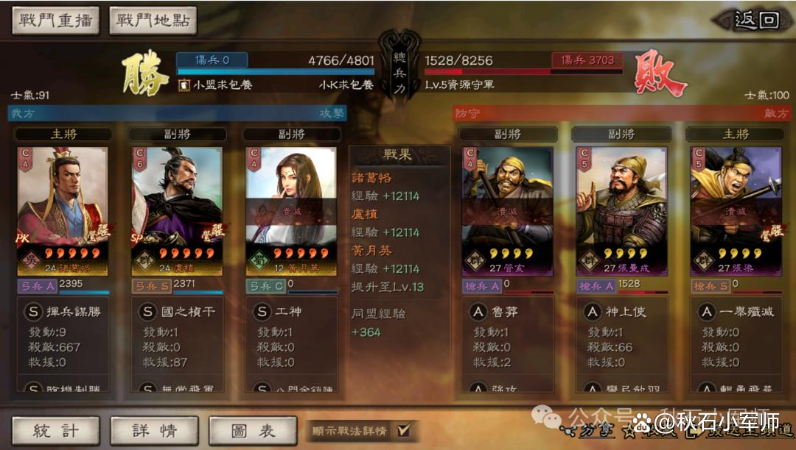

2+1, 24레벨, 조진 기병.

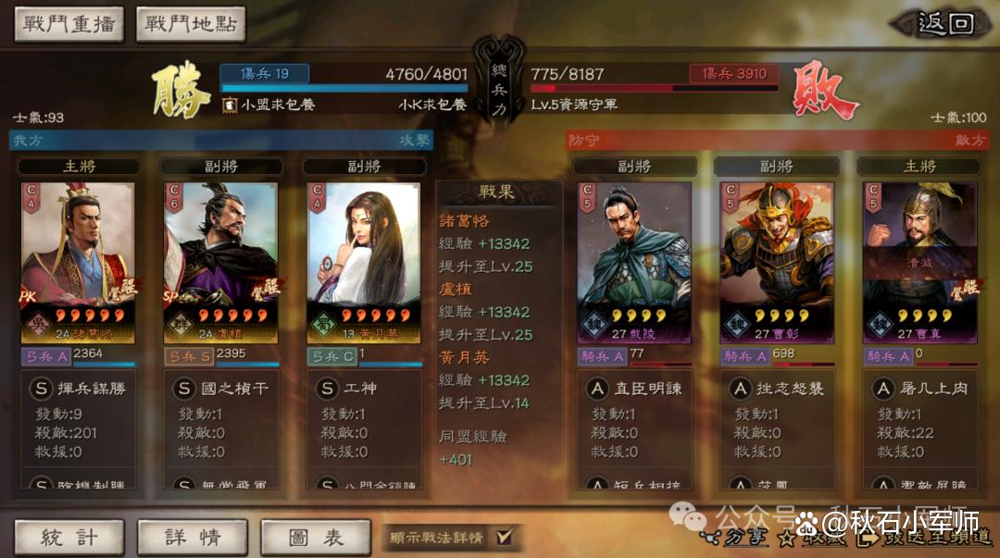

1+2, 26레벨, 진교 방패.

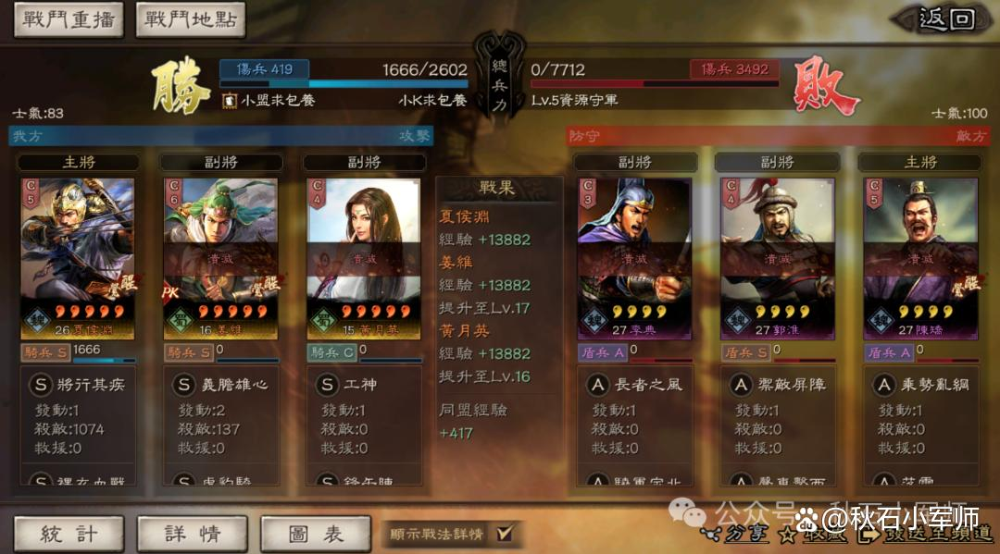

1+2, 26레벨, 장흠 궁병.

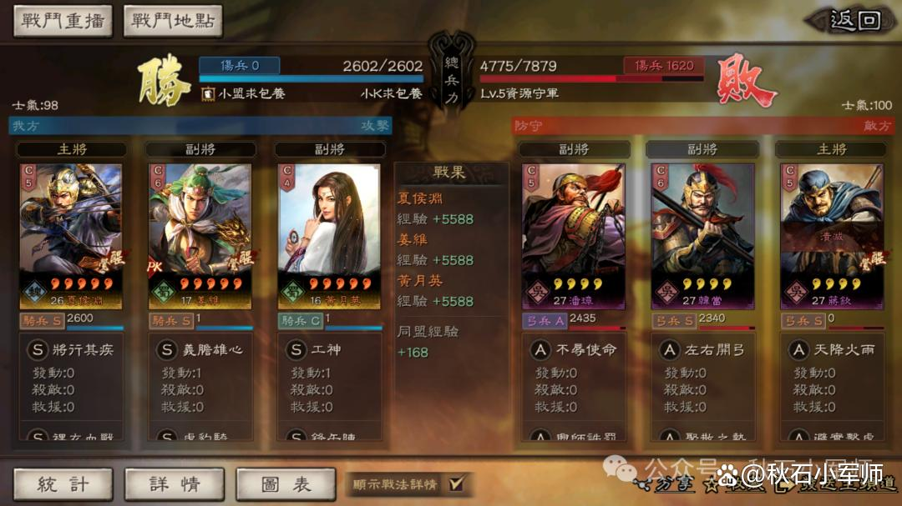

**참고: 노하제 세 장수만으로 짠 2+1 (송해리 PDF, 중국 원본 A18 전보)**

| 장수 | 전법 |
|---|---|
| SP노식 (주장) | 무당비군 + 임기제승 |
| 하후연 | 맨몸의 혈전 + 최봉단인 |
| 제갈각 (보조, 1병) | 팔문금쇄진 |

| 전보 | 상대 (5토) | 노식/하후연 레벨 | 아군 (전 → 후) | 적 시작 |
|---|---|---|---|---|
| A18-024 | 장흠 궁병 | 22 / 21 | 4,149 → 4,046 | 6,825 |
| A18-025 | 조진 기병 | 22 / 22 | 4,401 → 4,383 | 7,027 |

- 송해리 PDF는 이 두 장의 수비군 레벨을 적지 않았다. 그래서 위 기준(5토 27레벨)과 같은지 확인하지 못했다.

### 4.2 7본 뒤 노강제 만병 5토

강유가 하후연 자리에 들어간 뒤의 전보다. 두 장 모두 선공 없이 만병 9,000을 상대로 이겼다.

| 레벨 (노식/강유/제갈각) | 상대 (5토) | 수비군 (전 → 후) | 아군 (전 → 후) | 부상병 | 결과 |
|---|---|---|---|---|---|
| 26 / 18 / 27 | 이각 기병 (곽사·서영·이각) | 9,000 → 127 | 7,100 → 7,036 | 0 | 승리, 주장 격파 |
| 27 / 19 / 27 | 진무 방패 (정봉·낙통·진무) | 9,000 → 995 | 7,300 → 7,227 | 17 | 승리, 주장 격파 |

- 노강제 세팅: 노식 국지정간 + 무당비군, 강유 义胆雄心 + 상병벌모, 제갈각 挥兵谋胜 + 임기제승. 세 번째 칸은 화면에서 잘렸다.

노강제 26레벨, 이각 기병 만병.

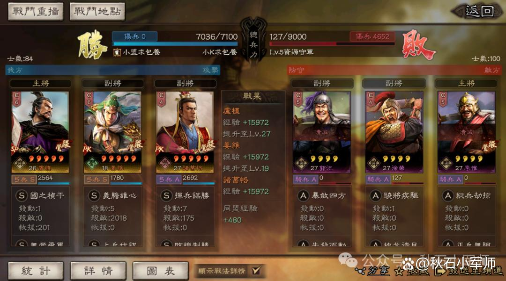

노강제 27레벨, 진무 방패 만병.

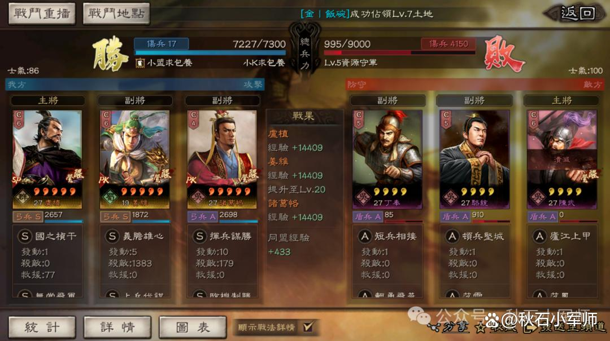

## 5. 6토·7토 전보

秋石은 "23레벨부터 6토를 열 수 있고 창병과 조창기를 권한다. 첫 6토는 반드시 선공으로 깎는다"고 적었다. 23레벨 6토 전보는 찾지 못해 25레벨 이후 전보만 올렸고, "고르지 않고 그날 나온 그대로 올렸다"고 밝혔다.

| 레벨 | 편성 | 토지 | 상대 | 수비군 (전 → 후) | 아군 (전 → 후) | 부상병 | 결과 |
|---|---|---|---|---|---|---|---|
| 25 / 25 / 26 | 노하제 | 6토 | 조창 기병 (악침·진랑·조창) | 14,165 → 495 | 7,600 → 7,162 | 107 | 승리, 주장 격파 |
| 26 / 26 / 27 | 노하제 | 6토 | 주환 기병 (반장·능조·주환) | 14,974 → 2,299 | 7,900 → 5,974 | 495 | 무승부 |
| 26 / 26 / 27 | 노하제 | 6토 | 문빙 방패 (조진·장패·문빙) | 15,000 → 0 | 5,968 → 5,436 | 63 | 승리, 전멸 |
| 27 / 20 / 27 | 노강제 | 6토 | 가규 창병 (악침·곽회·가규) | 14,305 → 989 | 7,400 → 6,763 | 96 | 승리, 주장 격파 |
| 27 / 20 / 27 | 노강제 | 6토 | 정봉 창병 (동습·진무·정봉) | 15,000 → 3,179 | 6,763 → 5,013 | 359 | 무승부 |
| 28 / 23 / 28 | 노강제 | 6토 | 조창 기병 (악침·진랑·조창) | 13,011 → 0 | 7,597 → 7,170 | 27 | 승리, 전멸 |
| 28 / 24 / 28 | 노강제 | 6토 | 곽회 방패 (대릉·진교·곽회) | 15,000 → 1,757 | 7,170 → 6,210 | 242 | 승리, 주장 격파 |
| 29 / 25 / 29 | 노강제 | 6토 | 정봉 창병 (동습·진무·정봉) | 15,000 → 2,489 | 9,295 → 9,024 | 69 | 승리, 주장 격파 |
| 29 / 25 / 29 | 노강제 | 6토 | 한당 궁병 (낙통·장흠·한당) | 15,000 → 2,008 | 9,024 → 8,736 | 88 | 승리, 주장 격파 |
| 29 / 26 / 29 | 노강제 | 6토 | 가규 창병 (악침·곽회·가규) | 15,000 → 0 | 9,173 → 8,199 | 461 | 승리, 전멸 |
| 34 / 33 / 34 | 노강제 | 7토 | 조운 창병 (오반·장억·조운) | 19,214 → 0 | 13,100 → 12,874 | 73 | 승리, 전멸 |
| 35 / 33 / 35 | 노강제 | 7토 | 장각 방패 (장보·장량·장각) | 21,000 → 3,744 | 12,874 → 9,238 | 1,464 | 무승부 |

- 레벨은 노하제가 노식/제갈각/하후연, 노강제가 노식/강유/제갈각 순서다.
- 노하제 본대 25레벨 조창기 화면에서 확인한 첫 장착 전법은 노식 무당비군, 제갈각 임기제승, 하후연 맨몸의 혈전이다. 세 번째 칸은 화면에서 잘렸다.
- 6토 실전 10전 가운데 무승부 2전(주환기, 정봉창)은 모두 만병에 가까운 수비군을 상대했다.
- 7토는 조운창 1교전을 이긴 뒤 같은 토지의 2교전 장각방패에서 무승부가 났다. 秋石은 이 덱이 방패병에 약하다고 적었다.

**노하제 본대 6토 (25~26레벨)**

6토, 25레벨, 조창 기병.

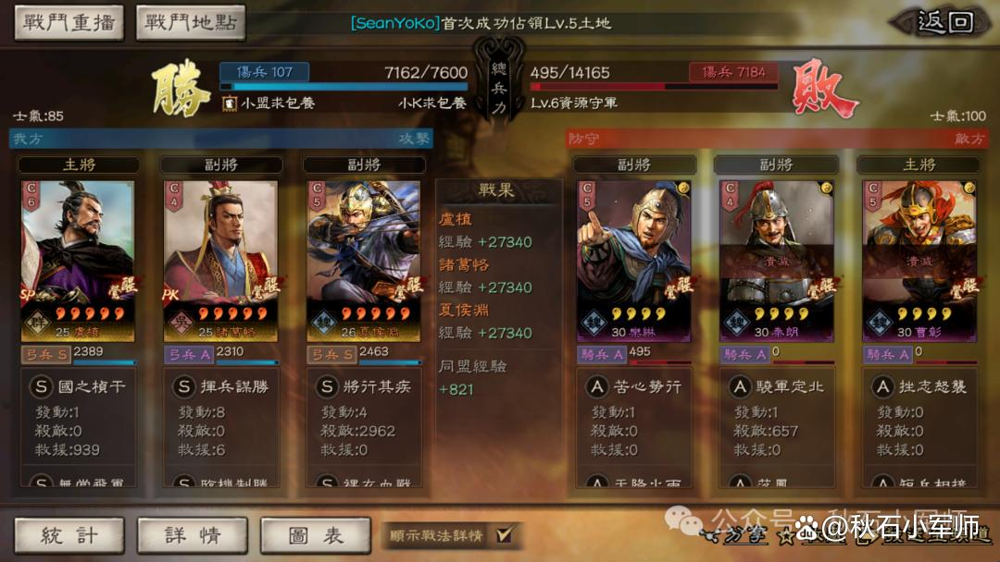

6토, 26레벨, 주환 기병 무승부.

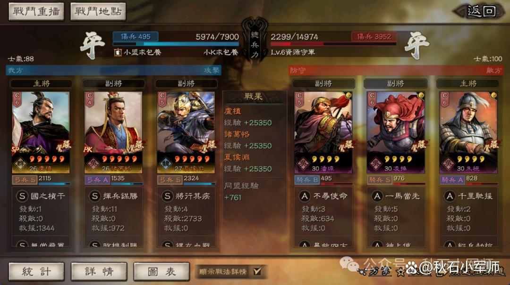

6토, 26레벨, 문빙 방패 만병 전멸.

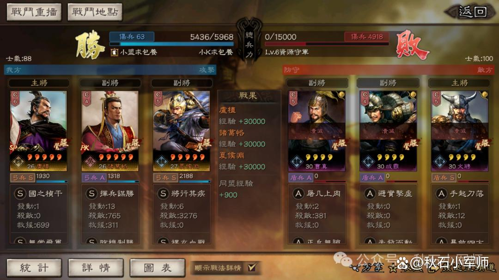

**노강제 6토 (27~29레벨)**

6토, 27레벨, 가규 창병.

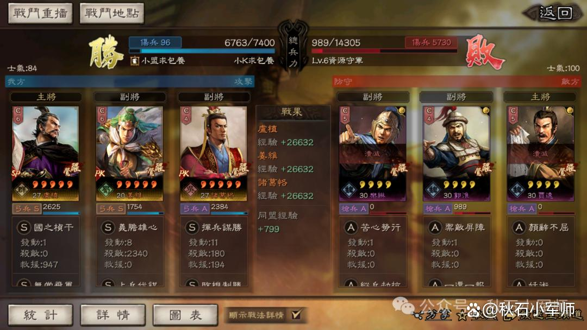

6토, 28레벨, 조창 기병 전멸.

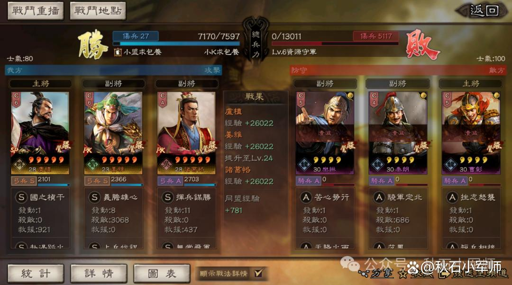

6토, 29레벨, 가규 창병 만병 전멸.

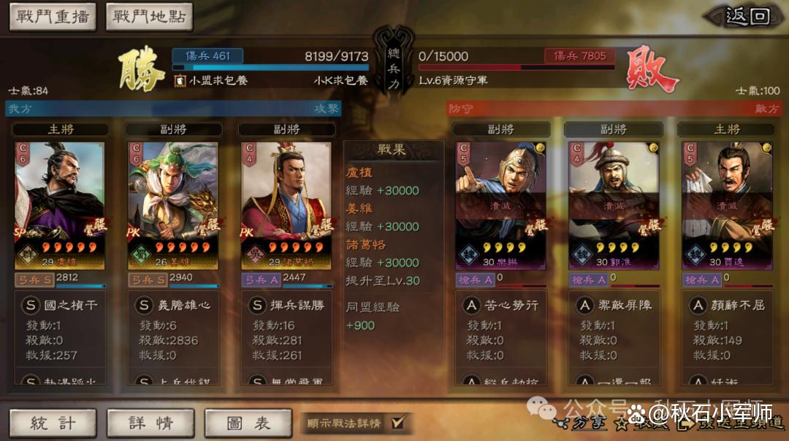

노강제 6토 나머지 4장 (정봉창 무승부·곽회방패·정봉창·한당궁)

6토, 27레벨, 정봉 창병 무승부.

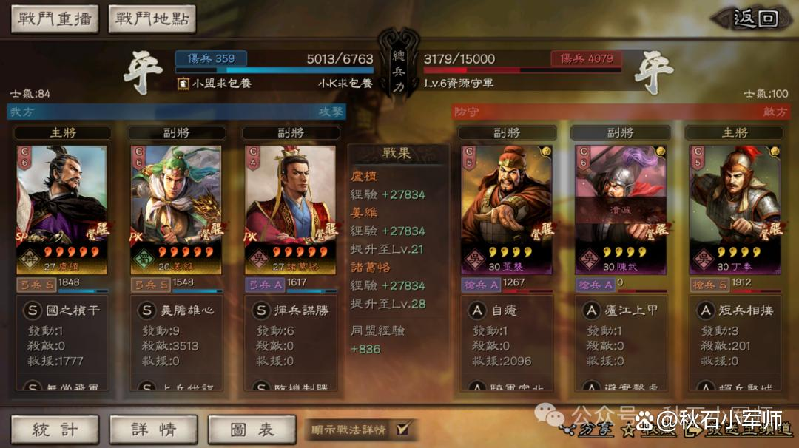

6토, 28레벨, 곽회 방패.

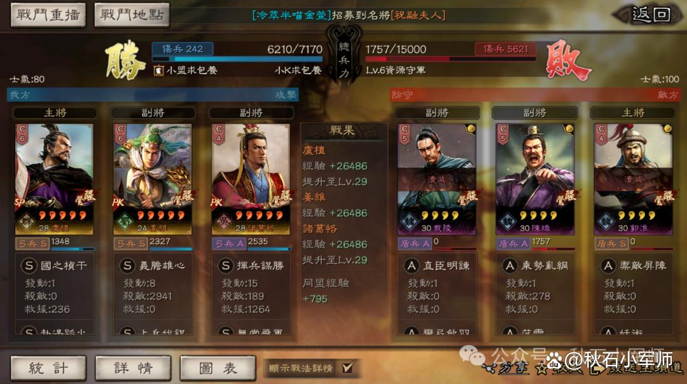

6토, 29레벨, 정봉 창병.

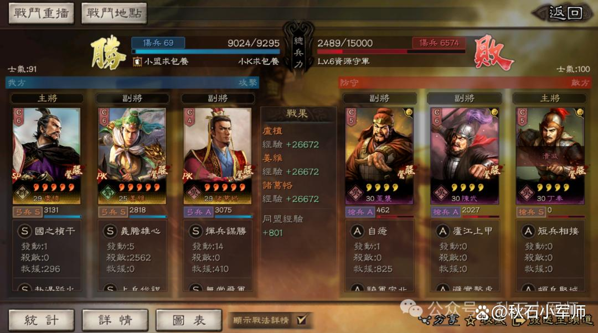

6토, 29레벨, 한당 궁병.

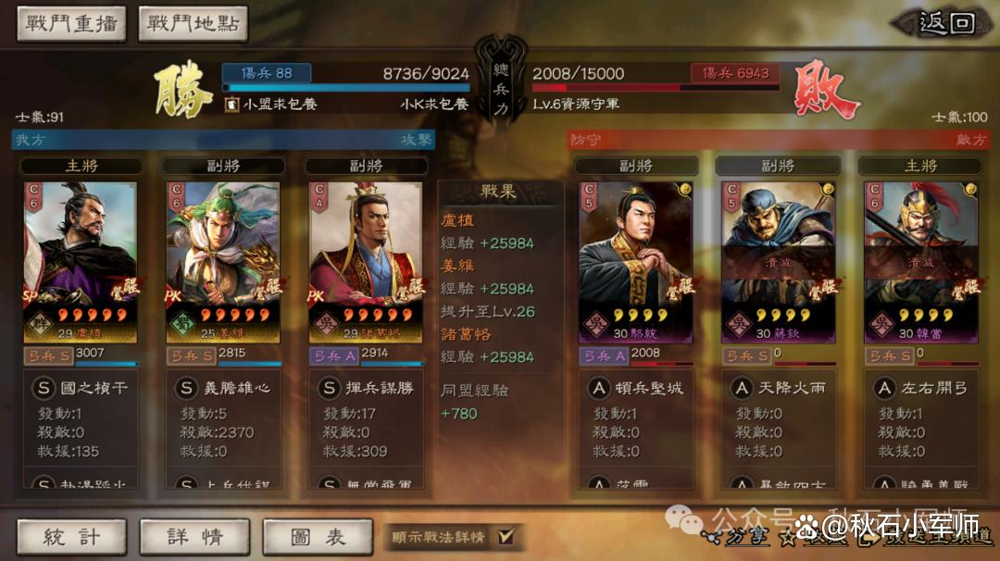

**노강제 7토 (34~35레벨)**

7토, 34레벨, 조운 창병 전멸.

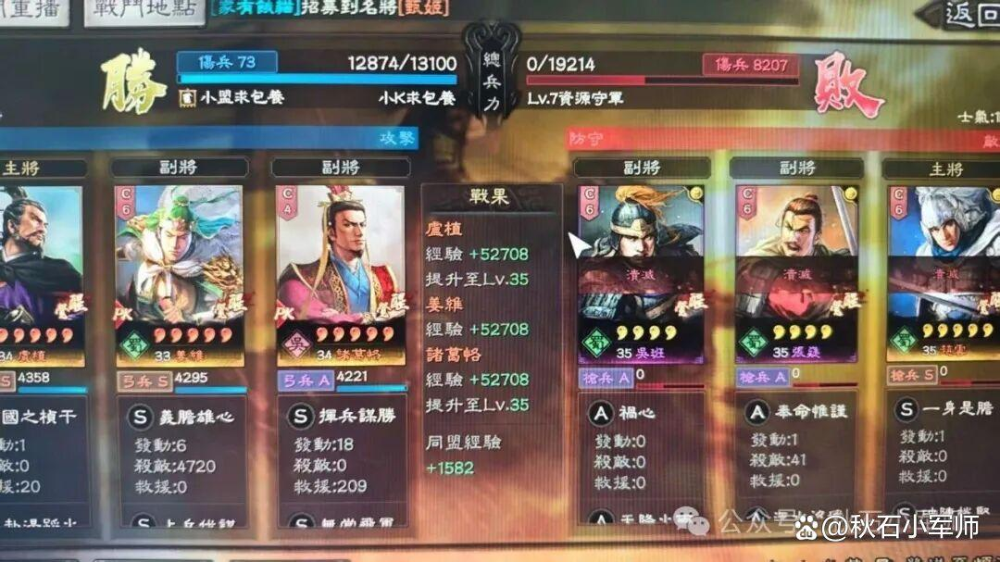

7토, 35레벨, 장각 방패 무승부.

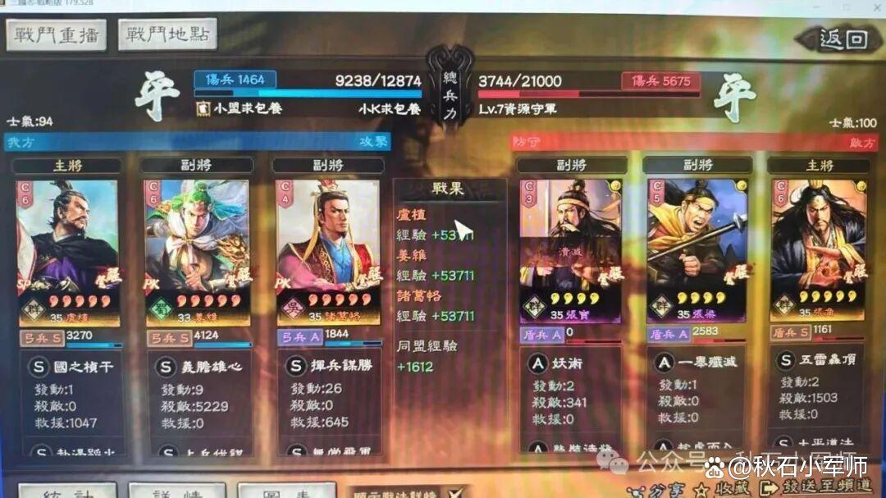

## 6. 운영 포인트

- **흐름(秋石 6/30)**: 21레벨부터 분할로 5토를 채우고, 23레벨에 6토를 연다. 7본 뒤 강유를 하후연 자리에 넣어 노강제로 6·7토를 친다. 24시간 세력은 12,690이었다.
- **강점(秋石 6/30)**: SP노식 고유 전법이 통솔 상승·피해 감소·흡혈을 한꺼번에 줘서 기세등등 없이도 5·6토에서 거의 뒤집히지 않는다고 했다. 위 전보도 6토 10전에 패배가 없다.
- **약점**: 방패병 상대가 힘들다(秋石). 제갈각 딜이 약해 20레벨 전 무승부가 잦고, 노하진보다 손실이 크다(知乎 6/19, 三战之光 9/1).
- **선공 원칙(三战之光 8/30)**: 1병 부대로 수비군을 먼저 깎은 뒤 본대를 넣는다. 가후 혼란대로 크게 깎고, 장양·손상향 같은 안정 딜 부대로 보탠다. 선공 뒤에는 전법 포인트를 본대로 되돌려 놓는다.
- **땅 고르기(三战之光 9/1)**: 창병·기병 토지를 먼저 치고 방패병은 피한다. 克制에서 얻는 피해 감소가 진궁이 없어 모자란 딜을 메워 준다고 했다.
- **무리하지 않기(三战之光 9/1)**: 진궁이 없으면 손실이 원래 크니 극한 랭킹 경쟁은 하지 말라고 했다.

24시간 세력 화면(秋石 6/30).

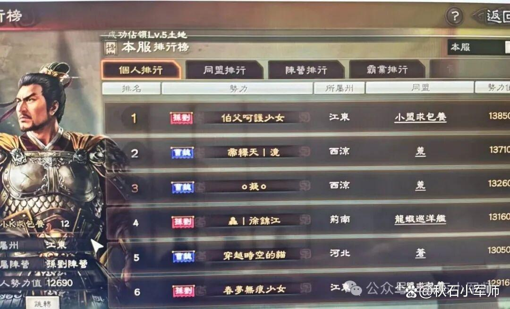

## 7. 확인하지 못한 것

- 노하제의 20레벨 이하 4·5토 전보(중국·대만 모두 미확보).
- 노하제 첫 6토(23레벨) 전보. 秋石도 찾지 못했다고 적었다.
- 노하제 전용 병서, 제갈각 가점의 정답(전통 대 전지).
- 분할 전보의 세 번째 전법 칸(화면에서 잘림).
- 송해리 PDF A18 전보의 수비군 레벨.
- 제갈각 고유 挥兵谋胜, 강유 고유 义胆雄心, 황월영 고유 工神, 특기 援助·灵动의 한국 명칭.
- 秋石 6/30 전보가 국제판 계정이라 중국 서버와 밸런스가 다를 수 있다.

## Sources

- [SP卢植体系开荒攻略：前期夏侯渊突脸，中期姜维接棒 (秋石小军师, 2026-06-30)](https://baijiahao.baidu.com/s?id=1869391490113012173)
- [没有陈宫的卢植开荒怎么玩？4套替代方案按优先级排好了 (三战之光青云, 2026-09-01)](https://baijiahao.baidu.com/s?id=1875088433014450006)
- [SP卢植开荒到底怎么玩，代练都怕你学会自己能玩了 (三战之光青云, 2026-08-31)](https://baijiahao.baidu.com/s?id=1874991129493734892)
- [争洛阳霸业冲榜开荒转型自用剧本万字笔记 (三战之光青云, 2026-08-30)](https://baijiahao.baidu.com/s?id=1874908084364168811)
- [极限开荒没有陈宫怎么办 (知乎, 2026-06-19)](https://zhuanlan.zhihu.com/p/2051369244382717255)
- [SP卢植开荒全细节 (三战林冲, 2026-05-07)](https://baijiahao.baidu.com/s?id=1864411407501008359)
- [龙舆争衡剧本开荒白皮书 (妖精团队, 2026-10-25, 搜狗微信 검색)](https://weixin.sogou.com/weixin?type=2&query=%E5%8D%A2%E5%A4%8F%E9%99%88%20%E5%BC%80%E8%8D%92)
- [디시 송해리: S27테섭분석최종, 노하진개척 (2026-11-05)](https://gall.dcinside.com/mgallery/board/view/?id=3kingdoms&no=375668)
- [구글 드라이브: 노하진·한궁 전환 PDF 폴더](https://drive.google.com/drive/folders/1xX_n3hQ5B1lQW8XwGFo7C-uTGkmkFRBX)
- [바하무트 검색: 盧夏恪](https://forum.gamer.com.tw/B.php?bsn=36815&qt=1&q=%E7%9B%A7%E5%A4%8F%E6%81%AA)
- [smlotto S27 전법 목록 (한국 명칭 대조)](http://smlotto.com/samjeon_s27.html)
