# 노하진(SP노식·하후연·진궁) 개척 정보 정리

- 작성일: 2026-11-05
- 기준: 중국 공중호(秋石小军师·妖精团队·好运来橙)와 百家号(三战林冲·三战之光青云), 知乎, 한국 디시 송해리 님 PDF를 대조해 정리. 전법·장수 이름은 한국 서버 표기로 옮김.
- 용어: **선공(碰瓷, 폭탄)** = 소수 병력 부대로 먼저 쳐서 수비군 병력을 깎는 것. **2+1** = 병력을 가진 주력 둘 + 1병 보조 하나. **1+2** = 주력 하나 + 보조 둘. **A18·A21·A22·A23** = 송해리 PDF가 구분한 중국 원본 전보 묶음 번호.
- 손실 수치는 전보 화면의 표시 병력 감소이며, 선공 비용은 포함하지 않는다.
- 妖精团队 표 이미지 5장은 한국 서버 명칭으로 다시 그린 한글 번역본이다. 원본은 각 그림 아래 링크로 남겼다. 토지 전보 스크린샷은 원본 그대로다.

## 0. 결론 요약

| 항목 | 결론 |
|---|---|
| 덱 평가 | 妖精团队 백서(2026-10-25) 종합 9.5점. 법마제(9.9) 다음, 만홍 대상 최강 개척덱 중 하나 |
| 공통 뼈대 | 노식 잠룡진 고정, 하후연 맨몸의 혈전+최봉단인 고정, 무당비군은 노식·진궁 중 한 명만 |
| 4토 | 만홍 5~8레벨, 백판 9~10레벨. 첫 장량창은 3,500까지 선공 후 진입 |
| 5토 | 만홍 10~13레벨, 백판 16~18레벨. 14레벨 전 6,300 이하, 18레벨 후 7,500 이하로 선공. 만홍 10레벨 진입 승리 3건, 11레벨 1건(3.1절) |
| 6토 | 첫 6토 22~23레벨(보수적으론 26~30). 12,000 이하로 선공 필수 |
| 7토 | 33~34레벨 + 군영 5급. 18,000 이하로 선공 |
| 분할 | 21레벨부터. 노식+진궁 2+1(창병 5토)과 하후연 1+2(진교 방패 5토)를 병행 |
| 24시간 세력 | 실전 12,170(秋石), 1.4만(林冲), 妖精 극한 기준 12,500+ |

## 1. 전법 세팅 (20레벨 전 / 후)

### 1.1 세팅표

| 장수 | 가점 | 20레벨 전 | 배치 A (秋石 실전 전보·知乎 次选) | 배치 B (妖精 백서·송해리 A21/A18) | 배치 C (송해리 A22) | 배치 D (송해리 A23) |
|---|---|---|---|---|---|---|
| SP노식 (주장) | 전통 | 잠룡진 | 잠룡진 + 기세등등 | 잠룡진 + 무당비군 | 잠룡진 + 기세등등 | 안행진 + 무당비군 |
| 하후연 | 전무 | 맨몸의 혈전 | 맨몸의 혈전 + 최봉단인 | 맨몸의 혈전 + 최봉단인 (또는 유리한 기회) | 맨몸의 혈전 + 최봉단인 | 맨몸의 혈전 + 최봉단인 |
| 진궁 | 전지 | 무당비군 | 무당비군 + 임기제승 | 임기제승 + 상병벌모 (妖精: 임기제승 + 기세등등/도심혹적) | 무당비군 + 도심혹적 | 도심혹적 + 임기제승 |

- **규칙**: 무당비군은 노식·진궁 중 한 명만 든다. 노식이 무당비군을 들면 특기를 灵动(한국명 미확인) 대신 援助(한국명 미확인)로 바꾼다(秋石). 하후연의 맨몸의 혈전+최봉단인은 모든 자료에서 고정이다.
- **20레벨 전 변형**: 三战林冲(4/17)은 노식 잠룡진 대신 기세등등. 林冲(5/7)은 "20레벨 전 하후연 맨몸의 혈전은 집중 공격당해 죽으니 최봉단인"을 권한다. 다만 秋石·송해리 전보 대부분은 20레벨 전에도 맨몸의 혈전이고, 최봉단인 단독형으로 10레벨 반장창 무승부(A22-038) 사례도 있어 우열은 확정되지 않았다.
- **수비형 변형(好运来橙 10/31, 실전 전보 없음)**: 노식 안행진+선등 결사대(1속·전통) / 하후연 맨몸의 혈전+최봉단인 / 진궁 잠피기봉+御敌屏障(한국명 "대항의 장벽" 추정, 전통).
- **홍도**: 노식은 만홍이 안정(최소 3홍). 하후연 3홍 이상, 만홍 권장(20레벨 전 주딜). 진궁은 백판도 가능하나 2홍 이하면 제갈각이 낫다는 평(知乎 6/19).
- **병서**: 노식 삼군병사·구전·통군(한궁으로 그대로 승계). 하후연 일고작기·승리·집예(好运来橙은 승리 대신 무략). 진궁은 好运来橙 기준 군형·避其锐气(한국명 미확인)+방비+수세.
- **7본 전환 세팅(16코 노진초)**: 노식 안행진+부탕도화 / 진궁 무당비군+임기제승 / SP초선 심장약허+상병벌모. 노식·초선이 같은 한 진영이라 잠룡진을 못 쓰고 안행진으로 바꾼다.
- **19코 한궁 완성**: 조조 도원결의+임기제승 / 노식 안행진+무당비군 / 초선 심장약허+상병벌모(송해리 A21). 妖精 백서는 노식 안행진+선등 결사대 / 초선 육력동심+演练战法 / 조조 강유병제+도원결의.

### 1.2 세팅 스크린샷

妖精团队 백서 세팅표 한글 번역본. 노하진 3명의 20레벨 전/후 세팅, 7본 대한(大汉) 전환 때 하후연 대신 들어가는 강유, 연기·한궁 전환 세팅과 병서가 함께 있다.

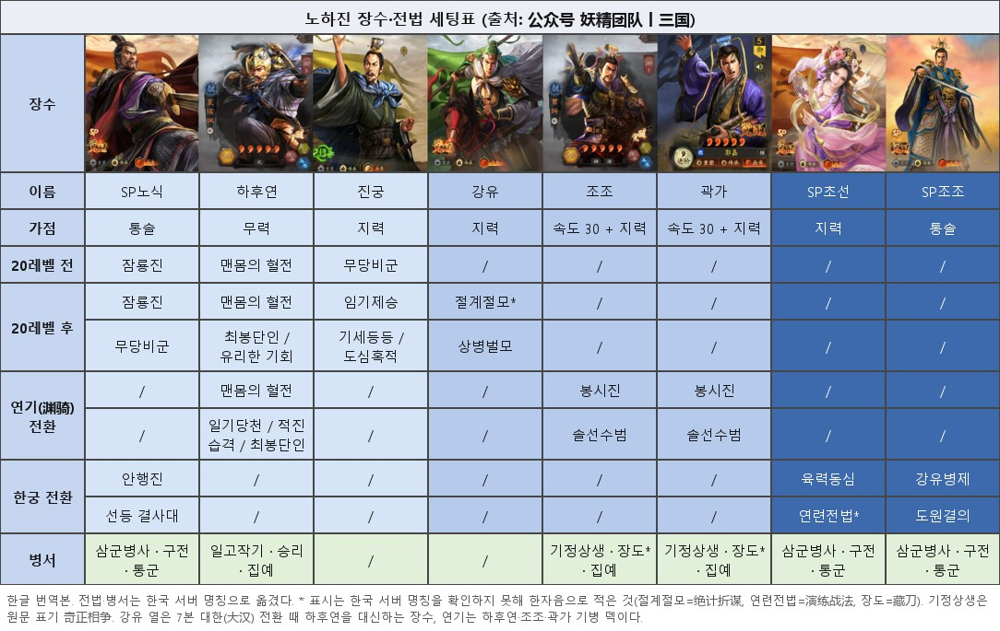

[원본 이미지](images/nohajin/yaojing_setup_table.jpg)

秋石 11/2 전보. 23레벨 첫 6토(가규 창병) 화면에 20레벨 후 세팅이 보인다: 노식 잠룡진+기세등등 / 하후연 맨몸의 혈전+최봉단인 / 진궁 무당비군+임기제승.

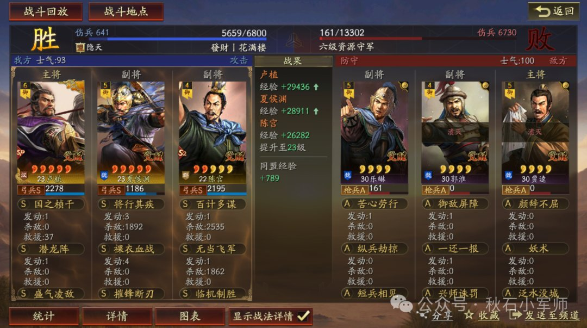

## 2. 토지별 적정 레벨·선공 기준·추천 수비장수

### 2.1 종합표

| 토지 | 진입 레벨 | 선공(碰瓷) 기준 | 추천 수비장수 (쉬운 순) | 피할 수비장수 | 실전 손실 참고 |
|---|---|---|---|---|---|
| 4토 | 만홍 5~8 / 백판 9~10 (妖精). 秋石 실전은 5레벨부터 | 첫 장량창 3,500까지, 주환창 4,000 이하(林冲). 8레벨 후 만병 장량창 가능 | 주환창, 장량창, 능조기, 곽사기 | 장익방패, 장흠궁, 황권궁, 조창방패 | 5~10레벨 3전 손실 207~247, 3개 먹고 10레벨 |
| 5토 | 만홍 10~13 / 백판 16~18 (妖精). 20레벨 후 안정 | 14레벨 전 6,300 이하, 18레벨 후 장량·반장창 7,500 이하, 야지 주장 2,500 이하(林冲) | 장량창, 반장창, 조진기, 이각기 | 황권궁, 장흠궁, 진무방패, 진교방패 | 10레벨 3건 부상병 0~223, 11레벨 19(3.1절). 13~19레벨 창병 7~143, 조진기 15레벨 1,252, 12레벨 장량창 무승부 |
| 6토 | 첫 6토 22~23 (林冲 22, 秋石·송해리 23, 妖精 23~26). 보수적으론 만홍 26~27 / 백판 28~30 | 12,000 이하. 문빙방패는 11,000 이하 | 가규창, 정봉창, 주치궁, 조창기, 주환기 | 곽회방패, 한당궁, 문빙방패 | 23레벨 2교전 합계 787~2,505(송해리 4사례), 秋石 1,141+1,125 |
| 7토 | 33~34 + 군영 5급 (林冲 33+5군영, 知乎 34+4군영, 秋石·송해리 34·34·33) | 18,000 이하 | 조운창, 장료창, 황개궁, 여포기 | 장각방패, 주유궁, 하후돈기, 제갈궁, 장비방패 | 장료창 409·여포기 1,368(송해리 A21), 조운창 1,445·여포기 2,720(秋石) |
| 8토 (참고) | 30레벨 노식 전환 후, 7군영 권장 | 감녕창만 선공 후(70% 안정, 林冲) | 감녕창 | 정욱기, 9토의 하후연기·등애 | 知乎: "8토가 유일한 고통, 협력 없는 진궁은 더 어려움" |

- 6토 순서는 妖精 표가 가규>정봉>주치궁>조창기, 林冲은 가규>정봉>조창(조창이 가장 쉬움)으로 약간 다르다. 첫 6토는 어느 쪽이든 선공 필수다.
- 노식 덱은 6·7·8토 모두 최대 병력의 90% 이상, 가능하면 만병으로 들어간다(林冲). 병력이 모자라면 들어가지 않는다.
- 수비군 병력이 아군의 3분의 1 밑이면 경험치가 없다는 설명이 妖精 백서에 있으나, 송해리는 반례(A18-030)를 들어 보류했다.

### 2.2 참고 이미지

妖精 백서 토지 난이도표의 노하진 부분(위에서 아래로 어려워짐).

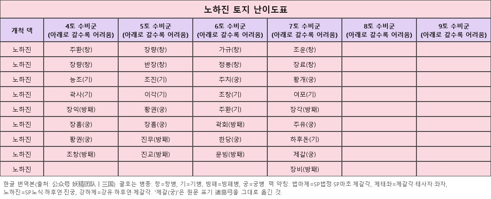

[원본 이미지](images/nohajin/yaojing_land_difficulty.jpg)

같은 표 전체(법마제·제태좌·노하진·강하제 비교). 8·9토 수비군은 법마제 칸에만 있다.

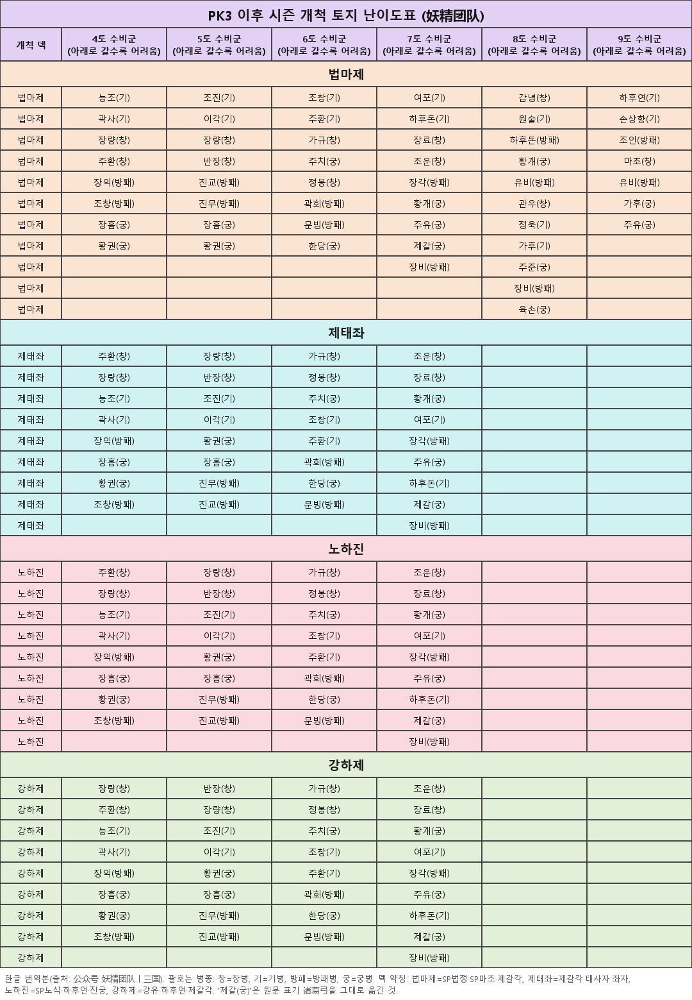

[원본 이미지](images/nohajin/yaojing_land_difficulty_all.jpg)

妖精 백서 선공 안전 병력선표(주력 레벨 × 홍도). 수비군을 표의 병력 이하로 깎은 뒤 본대로 들어간다.

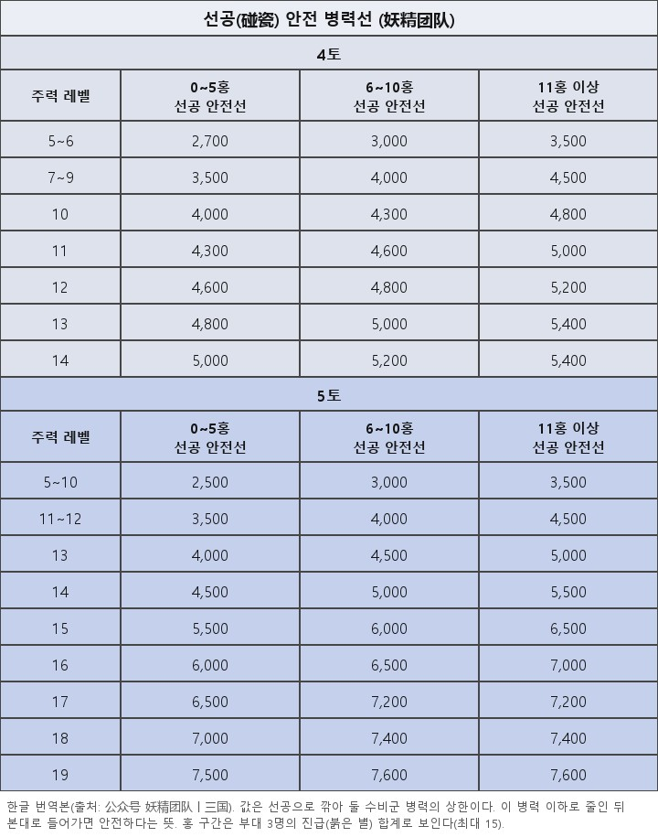

[원본 이미지](images/nohajin/yaojing_pengci_table.jpg)

## 3. 20레벨 이하 토지 전보 스크린샷 (秋石 11/2, 중국 서버)

세팅은 노식 잠룡진 / 하후연 맨몸의 혈전 / 진궁 무당비군. 모두 선공 후 진입한 화면이다.

| 레벨 | 토지 | 수비장수 | 아군 병력 변화 | 부상병 | 비고 |
|---|---|---|---|---|---|
| 5 | 4토 | 주환 창병(정봉·반장·주환) | 1,500 → 1,253 | 51 | 첫 4토 |
| 7→9 | 4토 | 장량 창병(장연·장만성·장량) | 2,100 → 1,890 | - | |
| 9→10 | 4토 | 능조 기병(주환·서성·능조) | 2,700 → 2,493 | 25 | 4토 3개로 10레벨 |
| 12 | 5토 | 장량 창병 | 3,600 → 1,997 | 346 | 무승부, 너무 이른 진입 |
| 13→14 | 5토 | 반장 창병(진무·주환·반장) | 3,900 → 3,113 | 115 | |
| 14→15 | 5토 | 반장 창병 | 4,200 → 3,867 | 7 | |
| 15→16 | 5토 | 조진 기병(대릉·조창·조진) | 4,500 → 3,248 | 591 | 기병은 창병보다 손실 큼 |
| 16 | 5토 | 장량 창병 | 4,600 → 4,211 | 47 | |
| 16→17 | 5토 | 반장 창병 | 4,785 → 3,966 | - | |
| 17→18 | 5토 | 장량 창병 | 5,100 → 4,888 | 80 | |
| 18 / 19 | 5토 | 반장 창병 | 5,200 → 5,028 / 5,400 → 5,214 | 51 | |
| 19 | 5토 | 장량 창병 | 5,700 → 5,405 | 117 | |
| 19→20 | 5토 | 조진 기병 | 5,700 → 5,593 | 6 | 20레벨 달성 |

4토, 5레벨, 주환 창병.

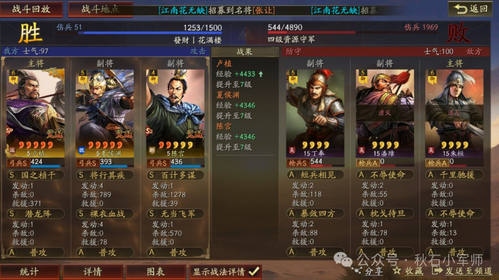

4토, 7→9레벨, 장량 창병.

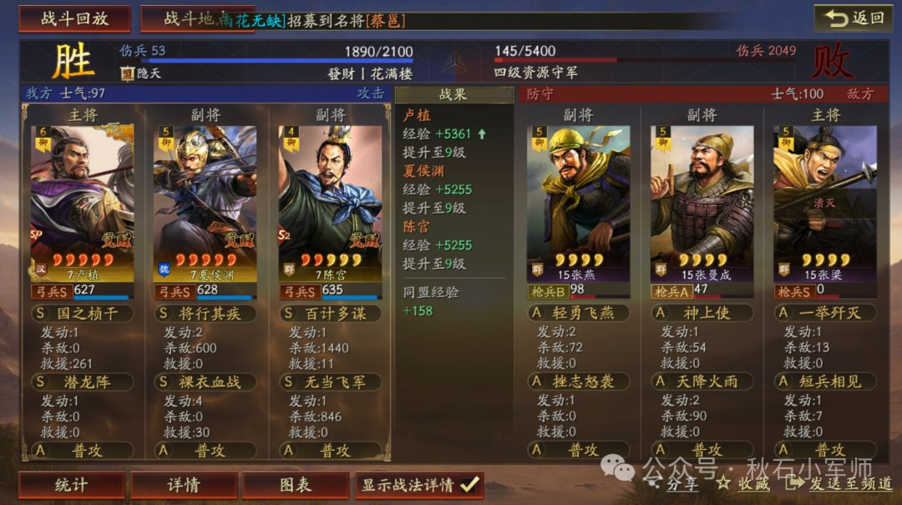

4토, 9→10레벨, 능조 기병.

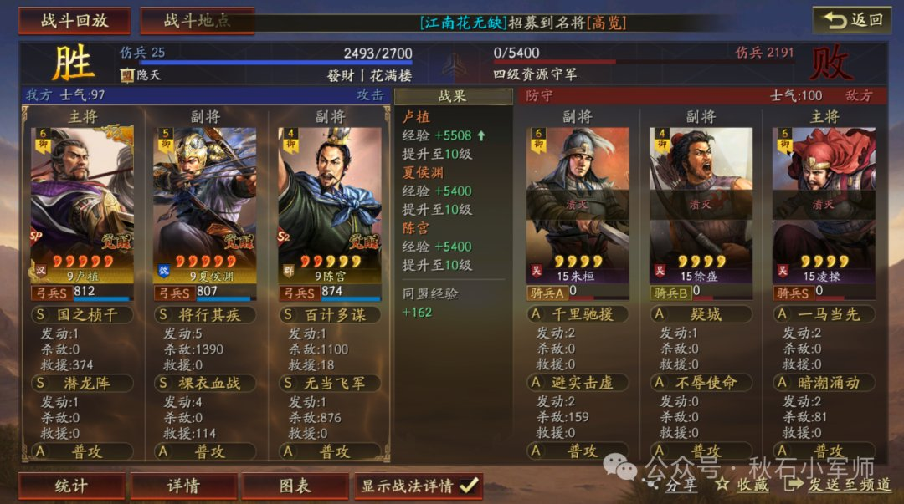

5토, 12레벨, 장량 창병 무승부. 5토를 너무 일찍 들어간 사례.

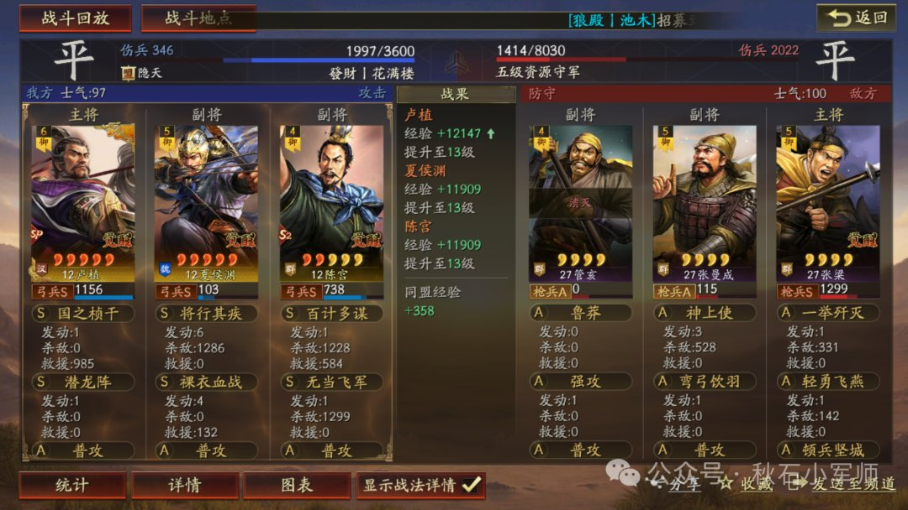

5토, 13→14레벨, 반장 창병.

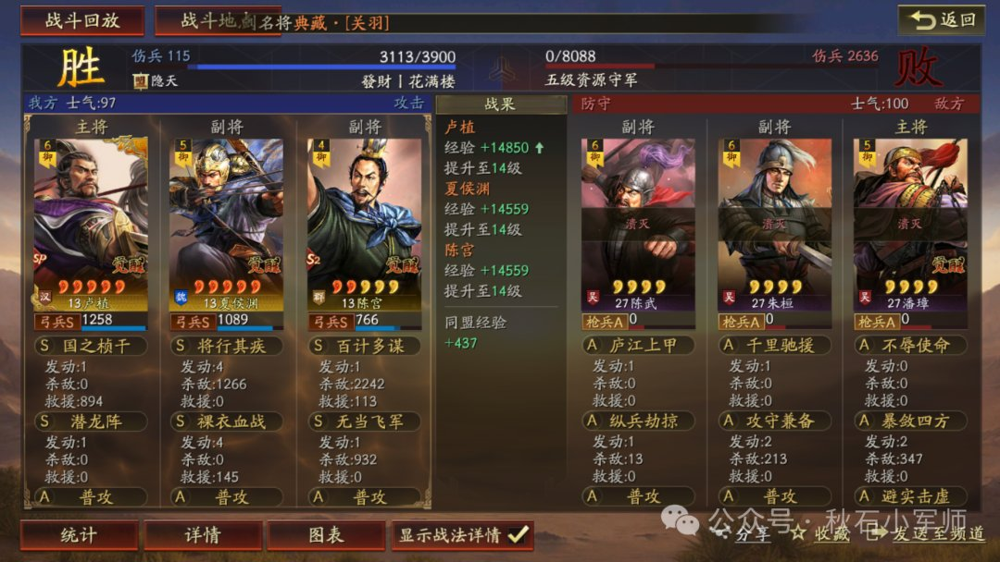

5토, 15→16레벨, 조진 기병. 기병은 창병보다 손실이 크다.

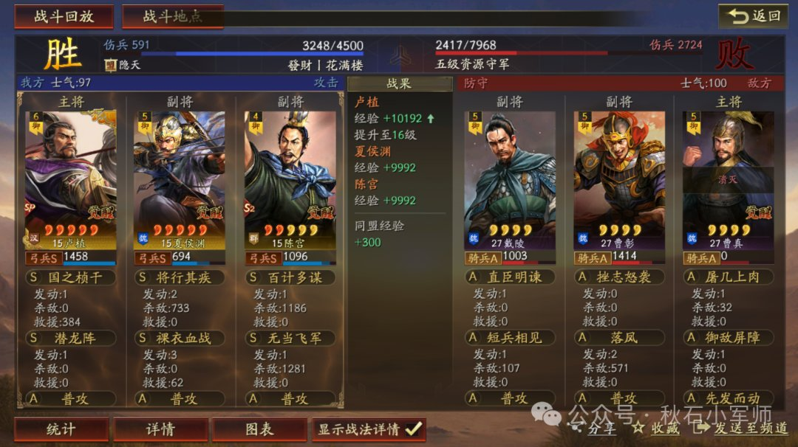

5토, 16레벨, 장량 창병.

5토, 17→18레벨, 장량 창병.

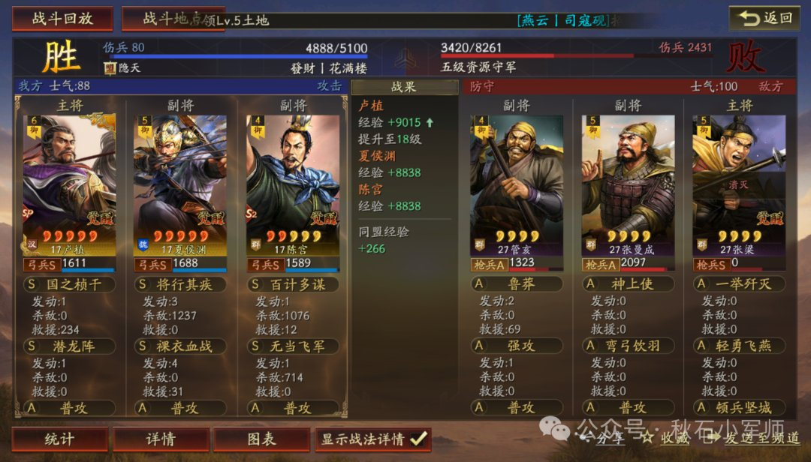

5토, 19→20레벨, 조진 기병. 이 전투로 20레벨 달성.

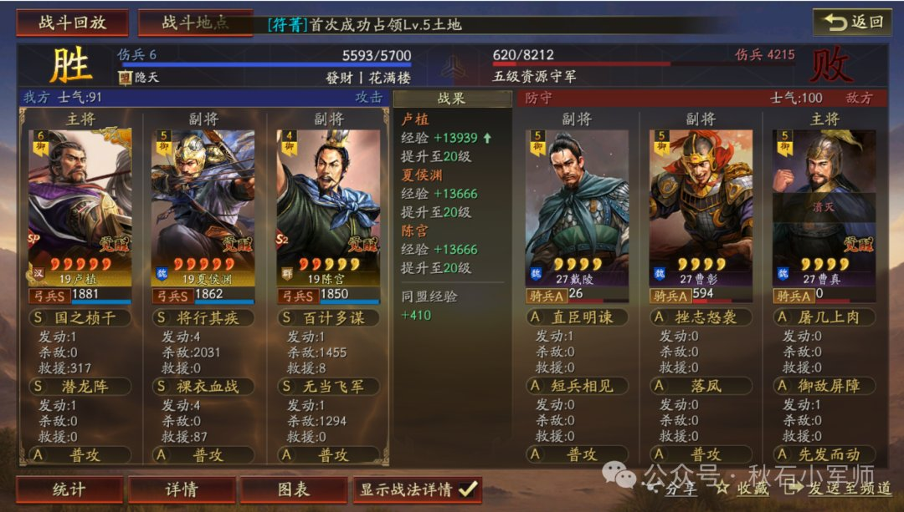

한국 서버 참고(송해리 PDF): 10레벨 반장창 무승부(3,000→1,918, 하후연 최봉단인형), 14레벨 반장창 무승부(4,200→3,408), 15레벨 반장창 승리(4,500→3,270). 송해리 방송 타임라인은 7레벨에서 2시간 17분 만에 20레벨, 첫 5토는 10레벨(적 시작 5,548로 사전 감소).

### 3.1 10·11레벨 5토 진입 전보 (중국 추가 자료)

중국 웹에서 노하진 본대가 10레벨과 11레벨에 5토를 친 전보 4장을 찾았다. 10레벨 3장, 11레벨 1장이며 모두 승리다. 세 명 모두 만홍(진급 5단계)이고, 모두 선공으로 수비군 병력을 먼저 깎은 뒤 들어갔다. 대만 웹(바하무트)에서는 해당 전보를 찾지 못했다.

| 출처 | 레벨 | 상대 (5토 수비군) | 수비군 병력 (전 → 후) | 아군 병력 (전 → 후) | 부상병 | 결과 | 경험치 |
|---|---|---|---|---|---|---|---|
| 秋石 5/25 (PK1 시즌) | 10 | 이각 기병 (이각·곽사·서영) | 5,235 → 0 | 3,000 → 2,866 | 0 | 승리, 수비군 전멸 | 6,984 |
| 秋石 5/25 (PK1 시즌) | 10 | 이각 기병 (이각·곽사·서영) | 5,921 → 3,178 | 3,000 → 2,581 | 223 | 승리, 주장 서영 격파. 11레벨 달성 | 3,658 |
| 拾史札 11/1 | 10 | 반장 창병 (진무·주환·반장) | 6,211 → 2,524 | 3,000 → 2,620 | 174 | 승리, 주장 반장 격파 | 6,637 |
| 秋石 5/25 (PK1 시즌) | 11 | 조홍 창병 (가규·문빙·조홍) | 6,518 → 0 | 3,300 → 2,945 | 19 | 승리, 수비군 전멸. 12레벨 달성 | 8,691 |

**전법 세팅 (화면에 보이는 그대로)**

| 장수 | 고유 전법 | 秋石 5/25 (10·11레벨) | 拾史札 11/1 (10레벨) |
|---|---|---|---|
| SP노식 (주장) | 국지정간 | 잠룡진 | 잠룡진 |
| 하후연 | 장수의 속도 | 맨몸의 혈전 | 최봉단인 |
| 진궁 | 百计多谋 (한국명 미확인) | 무당비군 | 무당비군 |

- **선공 수준**: 5토 만병은 9,000이다. 10레벨 첫 전투는 선공 두 번으로 5,235(58%)까지 깎은 뒤였다. 나머지 세 장도 5,921~6,518(66~72%)이 남은 상태에서 들어갔다. 妖精 선공 안전선표의 10레벨 값(11홍 이상 3,500)보다 훨씬 많이 남긴 채로 이긴 사례다.
- **선공 부대(秋石 10레벨 첫 땅)**: 1차는 능통·손상향(5레벨) 부대로 9,000을 7,991로 줄였다. 2차는 가후·태사자·성위(城卫) 부대로 7,991을 5,235로 줄였다. 둘 다 진 전투다.
- **주장 격파 승리**: 두 장은 수비군을 다 잡지 못하고 주장을 쓰러뜨려 이겼다. 땅은 얻지만 경험치는 전멸 승리보다 적다(3,658 대 6,984).
- **하후연 전법 비교**: 拾史札은 같은 부대가 14레벨에 맨몸의 혈전으로 바꿔 5토를 쳤을 때 부상병이 430으로 늘었다고 비교했다. 그래서 개척기에는 최봉단인처럼 받는 피해를 줄이는 전법이 낫다고 결론 내렸다. 반면 秋石은 10·11레벨에 맨몸의 혈전으로 부상병 0~223을 냈다. 상대와 시즌이 달라 우열을 정할 수 없다.
- **拾史札의 경고**: 10레벨 5토 진입은 시간이 급할 때만 이득이라고 본다. 같은 체력으로 17레벨에 치면 경험치 12,232에 부상병 49로, 10레벨보다 경험치는 두 배이고 손실은 3분의 1이라는 계산이다.
- **시즌 차이**: 秋石 5/25 전보는 PK1 시즌이라 수비군 구성이 지금 시즌과 다르다. 拾史札 11/1은 지금 중국 시즌 전보다.

10레벨 5토, 이각 기병, 수비군 전멸(秋石 5/25).

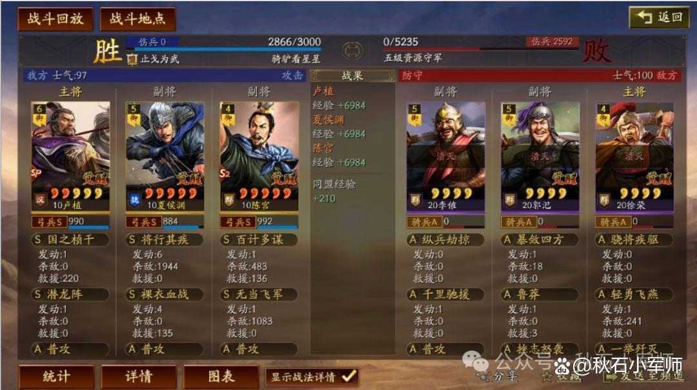

10레벨 5토, 이각 기병, 주장 서영 격파 승리(秋石 5/25).

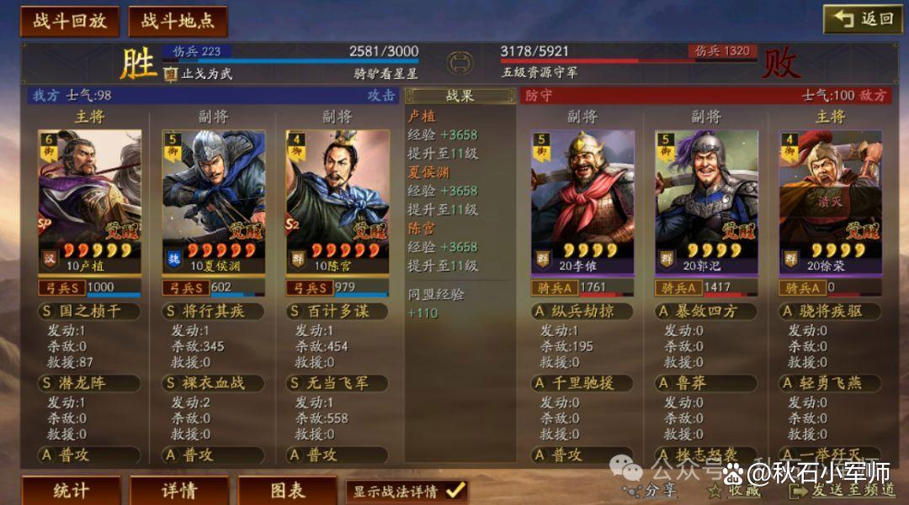

10레벨 5토, 반장 창병, 주장 반장 격파 승리(拾史札 11/1). 하후연이 최봉단인을 든 세팅.

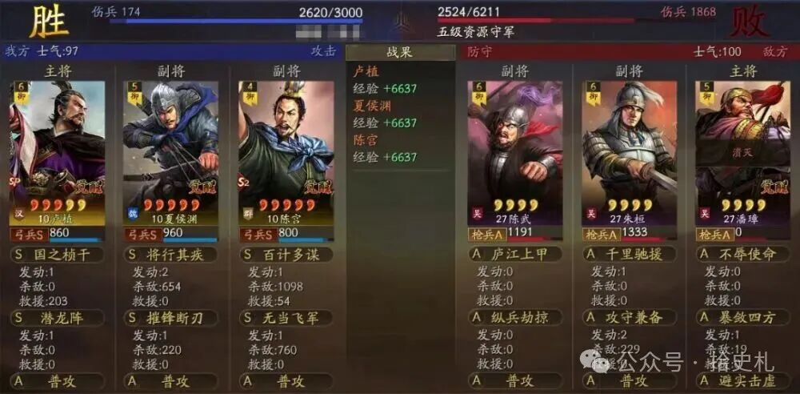

11레벨 5토, 조홍 창병(가규·문빙·조홍), 수비군 전멸(秋石 5/25).

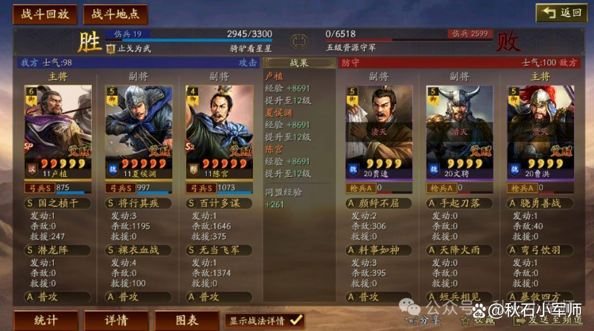

10레벨 첫 5토 전의 선공 화면 2장 (秋石 5/25)

1차 선공: 능통·손상향, 수비군 9,000 → 7,991.

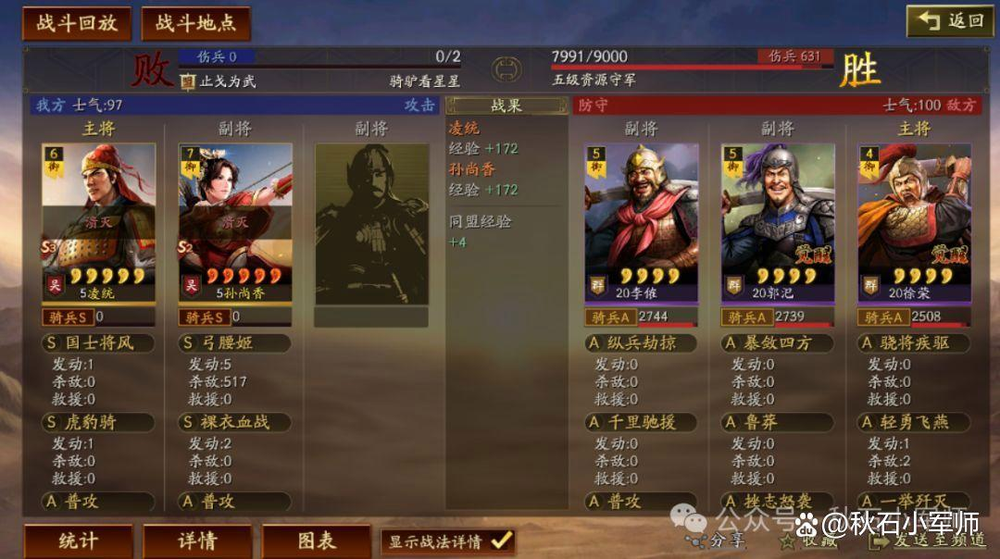

2차 선공: 가후·태사자·성위, 수비군 7,991 → 5,235.

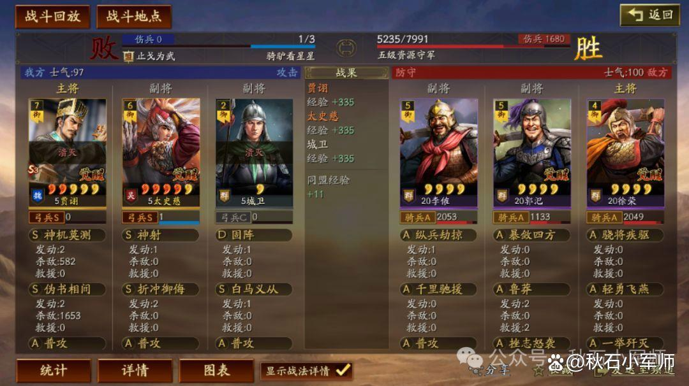

## 4. 6토·7토 전보 스크린샷 (秋石 11/2)

| 레벨 | 토지 | 수비장수 | 아군 병력 변화 | 부상병 | 비고 |
|---|---|---|---|---|---|
| 23 | 6토 | 가규 창병(악침·곽회·가규) | 6,800 → 5,659 | 641 | 첫 6토, 선공 후 |
| 23→24 | 6토 | 곽회 방패(대릉·진교·곽회) | 5,659 → 4,534 | 238 | 같은 토지 2교전째 |
| 34·33·33 | 7토 | 조운 창병(오반·장억·조운) | 13,000 → 11,555 | 516 | 초선 전환 후(노식·진궁·SP초선) |
| 34·33·33 | 7토 | 여포 기병(서영·이각·여포) | 11,555 → 8,835 | 817 | 같은 토지 2교전째 |

6토, 23레벨, 가규 창병. 세팅은 1.2절 그림 참고.

6토, 23→24레벨, 곽회 방패.

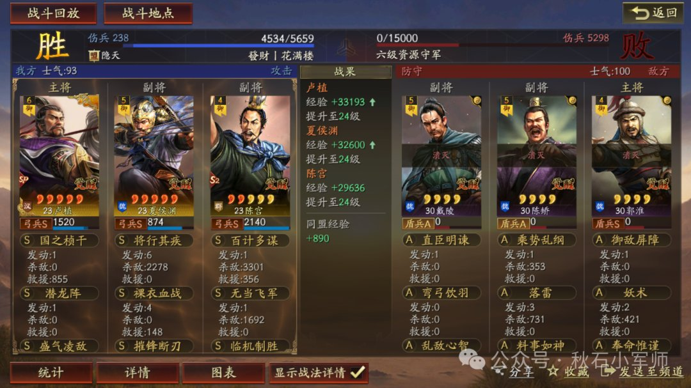

7토, 34레벨, 조운 창병. 초선 전환형(노식 34·초선 33·진궁 33).

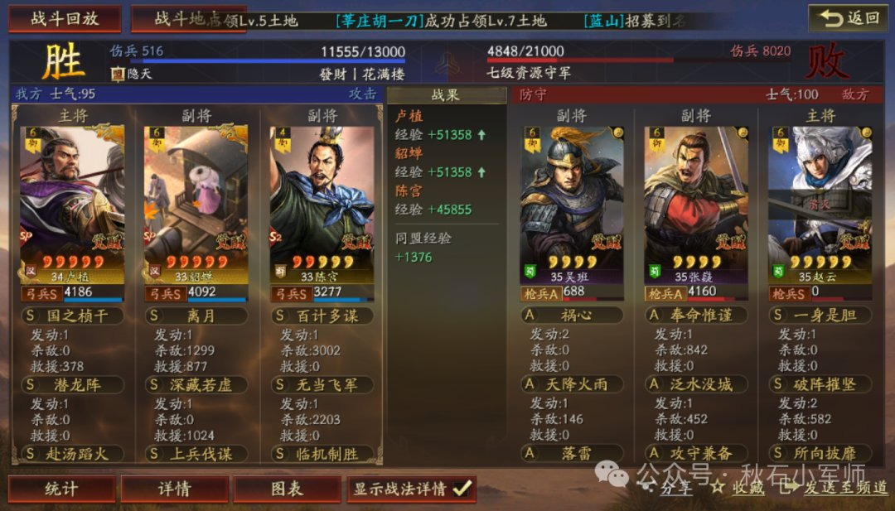

7토, 34레벨, 여포 기병.

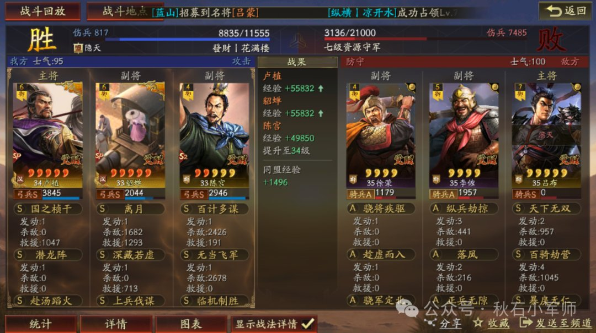

송해리 PDF의 한국어 정리 전보(23레벨 6토 4사례): A21 잠룡진·무진급 진궁 본대 손실 2,505 / A18 잠룡진·고진급 787 / A22 잠룡진·고진급 2,229 / A23 안행진 1,093. 7토는 34·34·33레벨 13,036병으로 장료창 409, 여포기 1,368.

## 5. 20레벨 이후 분할: 2+1로 5토 먹기 (전법 포함)

### 5.1 언제, 왜 분할하나

- 시작 시점은 21레벨(妖精 백서, 林冲 4/17). 知乎 1/28은 22레벨 분할. 송해리 PDF도 주력 21레벨 2+1, 하후연 22레벨 1+2 성공 화면을 확인했다.
- 林冲 4/17: 21레벨부터 각 부대 4회씩 분할한 뒤 하후연·여몽·황월영으로 5토를 채우고, 17시 전 7본.
- 林冲 5/7: 하후연만 단독 분할(1+2)하고 노식·진궁 체력은 한 방울도 안 쓰고 6토 보충용으로 남긴다. 분할 8~9회, 그 사이 강유를 16레벨까지 올린다.
- 분할 전법은 본대 세팅을 그대로 옮기지 않는다. 잠룡진은 3진영이 필요해 분할대에서 못 쓴다(송해리).
- 같은 장수(황월영 등)는 두 부대에 동시에 못 들어간다. 번갈아 쓰거나 다른 보조를 준비한다.

### 5.2 중국 자료의 추천 분할 세팅

| 출처 | 부대 | 세팅 (한국 서버 명칭) | 대상 5토 |
|---|---|---|---|
| 妖精 백서 | 노식+진궁 2+1 (궁병) | 진궁 불꽃바람 또는 임기제승 / 노식 기세등등·불타는 군영·상병벌모 중 택 / 황월영 무당비군 | 모든 창병(반장 우선) |
| 妖精 백서 | 하후연 1+2 (기병) | 하후연 맨몸의 혈전 또는 적진 습격 / 이전 또는 여몽 / 황월영. 보조가 봉시진·호표기 | 방패(진교만) |
| 林冲 5/7 | 하후연 1+2 (기병) | 하후연 맨몸의 혈전+적진 습격 / 강유 호표기 / 황월영 봉시진 | 진교방패 7,500 이하, 황권궁 6,500 이하, 진무방패 5,500 이하로 선공 후 |
| 林冲 5/7 (후반 선공대) | 하후연 1+2 | 하후연 맨몸의 혈전+적진 습격 / 주태 봉시진 / 황월영 호표기 | 6토 선공용 |

### 5.3 실제 전보로 확인된 세팅 (송해리 PDF, 중국 원본 전보 A18·A22)

**형 1. 하후연+진궁 2+1 (진궁 주장, 궁병)**

| 장수 | 전법 | 병력 |
|---|---|---|
| 진궁 (주장) | 무당비군 + 임기제승 | 21레벨 2,100 |
| 하후연 | 최봉단인 + 맨몸의 혈전 | 21레벨 2,100 |
| 태사자 (보조) | 기세등등 | 5~9레벨 1병 |

| 전보 | 상대 | 아군 시작 → 종료 | 적 시작 (만병 9,000) |
|---|---|---|---|
| A18-020 | 5토 장흠 궁병 | 4,201 → 4,201 | 6,747 |
| A18-021 | 5토 장흠 궁병 | 4,201 → 4,201 | 7,062 |

**형 2. 노식+진궁 2+1 (노식 주장, 궁병)**

| 장수 | 전법 |
|---|---|
| SP노식 (주장) | 무당비군 + 불타는 군영 (A22는 무당비군 + 불꽃바람) |
| 진궁 | 상병벌모 + 임기제승 |
| 보조 (1병) | 황월영 기세등등 / 제갈각 기세등등 / 좌자 팔문금쇄진 |

| 전보 | 상대 | 노식/진궁 레벨 | 보조 | 아군 시작 → 종료 | 적 시작 |
|---|---|---|---|---|---|
| A18-022 | 이각 기병 | 21 / 21 | 황월영 6 | 4,201 → 4,169 | 6,674 |
| A18-023 | 장량 창병 | 21 / 22 | 제갈각 5 | 4,176 → 3,821 | 8,311 |
| A18-029 | 반장 창병 | 22 / 22 | 좌자 5 | 4,401 → 4,359 | 6,922 |
| A18-031 | 장량 창병 | 23 / 22 | 좌자 10 | 4,360 → 4,334 | 7,174 |
| A18-033 | 반장 창병 | 23 / 23 | 좌자 11 | 4,474 → 4,425 | 7,952 |
| A22-057 | 장량 창병 | 25 / 25 | 황월영 12 | 5,001 → 4,892 | 7,313 |

**형 3. 노식+하후연 2+1 (노식 주장, 궁병, 진궁 대신 제갈각 보조)**

| 장수 | 전법 |
|---|---|
| SP노식 (주장) | 무당비군 + 임기제승 |
| 하후연 | 맨몸의 혈전 + 최봉단인 |
| 제갈각 (보조, 1병) | 팔문금쇄진 |

| 전보 | 상대 | 노식/하후연 레벨 | 아군 시작 → 종료 | 적 시작 |
|---|---|---|---|---|
| A18-024 | 장흠 궁병 | 22 / 21 | 4,149 → 4,046 | 6,825 |
| A18-025 | 조진 기병 | 22 / 22 | 4,401 → 4,383 | 7,027 |

**형 4. 하후연 1+2 (하후연 주장, 기병)**

| 장수 | 전법 (A18) | 전법 (A22-056) |
|---|---|---|
| 하후연 (주장) | 맨몸의 혈전 + 적진 습격 | 맨몸의 혈전 + 일기당천 |
| 보조 1 | 태사자 호표기 | 황월영 호표기 |
| 보조 2 | 황월영 봉시진 | 강유 봉시진 |

| 전보 | 상대 | 하후연 레벨 | 아군 시작 → 종료 | 적 시작 | 비고 |
|---|---|---|---|---|---|
| A18-028 | 진교 방패 | 22 | 2,188 → 2,107 | 6,369 | |
| A18-032 | 진교 방패 | 23 | 2,302 → 2,257 | 8,088 | |
| A22-056 | 진교 방패 | 25 | 2,502 → 2,412 | 8,726 | 사전 감소 3%뿐 |
| A18-034 | 장흠 궁병 | 24 | 2,002 → 2,002 | 7,417 | 적 3,600 잔존 승리 |
| A18-030 | 황권 궁병 | 22 | 2,155 → 887 | 6,565 | 58.8% 감소, 고손실 |

- 하후연 1+2는 진교 방패에서 손실 45~90으로 매우 안정적이지만, 황권 궁병은 22레벨에서 절반 이상을 잃었다. 아무 상대나 1+2로 치지 않는다.
- 위 전보는 전부 적 병력이 사전 감소된 조건이다. 무폭탄 만병 5토의 안정 레벨은 송해리도 확정하지 않았다.

### 5.4 2+1 순환과 1+2 병행의 체력 효율 (송해리 계산)

| 운용 | 출전 조합 | 주력 체력 사용 | 점령 수 |
|---|---|---|---|
| 2+1 순환 | 노식+진궁 / 노식+하후연 / 진궁+하후연 (각 보조 1명) | 주력 각 2회 | 3개 |
| 노진 2+1 + 하후연 1+2 | 노식+진궁+보조 2회, 하후연+보조 둘 2회 | 주력 각 2회 | 4개 |

주력 체력이 같을 때 하후연을 떼어 1+2로 돌리면 한 토지를 더 먹는다. 대신 보조 체력 사용은 두 배(3회 → 6회)이고, 점령 4개가 주력 경험치 33% 증가를 뜻하지는 않는다.

## 6. 운영 포인트

- **시간표(林冲 5/7, 서버 10시 오픈 기준)**: 10:00~10:30 4토 3개 → 10:30~14:30 5토 12~13개로 20레벨 → 14:30~16:30 22레벨 6토 + 하후연 분할 → 18:30 전 7본 → 21:30 이후 2군영 후 6토 → 다음 날 7토.
- **妖精 극한 기준**: 11:00 첫 5토, 13:30 20레벨, 15:00 첫 6토(23~26레벨), 21:00 7본, 24시간 세력 12,500+ 31레벨+, 48시간 14,000+ 34레벨+ 7토 5개 이상, 72시간 18,000+ 전환 40레벨+.

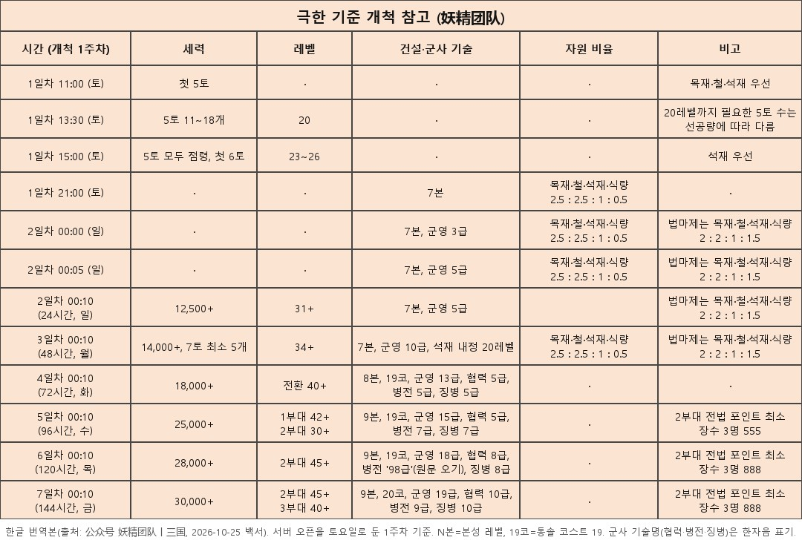

[원본 이미지](images/nohajin/yaojing_timeline_extreme.jpg)

- **7본 전환**: 하후연을 SP초선으로 교체한 16코 노진초로 6·7토를 열고, 19코 한궁(SP조조·SP노식·SP초선)으로 마무리. 신규 기간 세력을 더 올리려면 초선 대신 강유(지력, 絶計折謀+상병벌모)가 더 안정적이라는 것이 秋石·妖精 공통 의견이다.
- **24시간 세력**: 秋石 실전 12,170(서버 1위 13,070), 林冲 1.4만. 46~47시간에 한궁 전환.

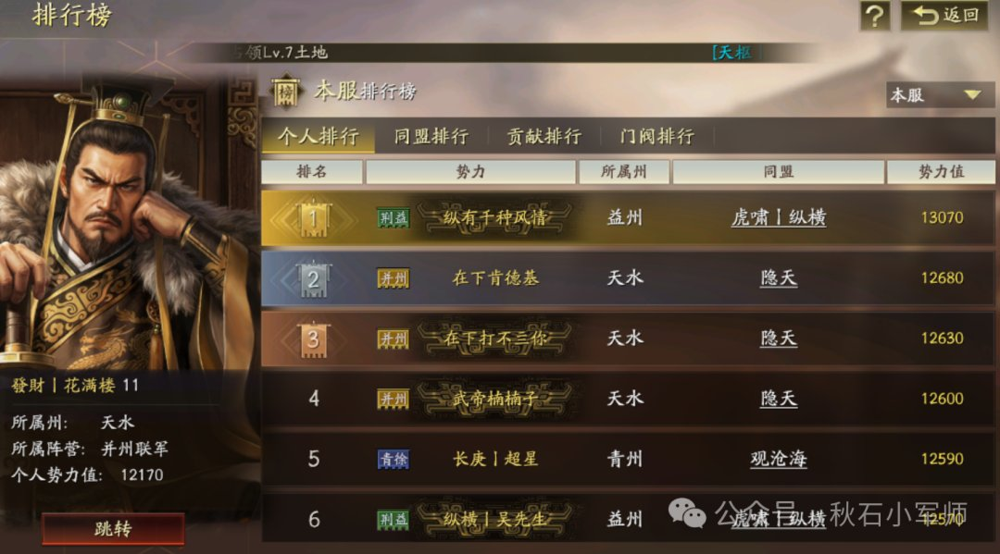

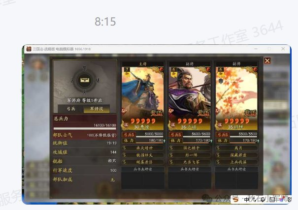

- **대만**: 바하무트에는 노하진 전용 공략이 없고, SP노식 검색 결과는 대인전 조합 질문 2건뿐이다.
- **한국**: 디시 송해리 님이 2026-11-05 올린 "노하진 숙련자 개척 가이드"(87쪽)와 "노하진 방송 타임라인 가이드" PDF가 구글 드라이브에 공개돼 있다. 중국 전보를 한국 전법명으로 옮겨 놓아 명칭 대조에 좋다.

## 7. 확인하지 못한 것

- 속도 가점 수치와 행동 순서, 장비.
- 병서 避其锐气·藏刀, 특기 援助·灵动, 전법 演练战法·绝计折谋의 한국 명칭(표 번역본에는 한자음 장도·연련전법·절계절모로 적음). 御敌屏障=대항의 장벽도 추정이다.
- 20레벨 전 하후연 맨몸의 혈전 대 최봉단인의 우열.
- 무폭탄 만병 5토·6토의 안정 레벨(송해리도 확정 불가라고 명시).
- 2+1 대 1+2의 승률 비교(같은 조건 반복 대조 없음).
- 8토 전보(송해리 PDF도 8토 전투 화면 미확보).
- 대만 웹의 10·11레벨 5토 전보(바하무트에 노하진 개척 글 없음), 진궁 고유 전법 百计多谋의 한국 명칭.
- 송해리 PDF의 전보 화면은 내려받지 않아 이 문서에 넣지 못했다(5절 수치는 PDF 본문에서 옮김).

## Sources

- [卢夏陈开荒47小时转型汉弓 (秋石小军师, 2026-11-02, 搜狗微信 검색)](https://weixin.sogou.com/weixin?type=2&query=%E5%8D%A2%E5%A4%8F%E9%99%88%20%E5%BC%80%E8%8D%92)
- [龙舆争衡剧本开荒白皮书 (妖精团队, 2026-10-25, 같은 검색)](https://weixin.sogou.com/weixin?type=2&query=%E5%8D%A2%E5%A4%8F%E9%99%88%20%E5%BC%80%E8%8D%92)
- [龙舆争衡开荒18强 (好运来橙, 2026-10-31, 같은 검색)](https://weixin.sogou.com/weixin?type=2&query=%E5%8D%A2%E5%A4%8F%E9%99%88%20%E5%BC%80%E8%8D%92)
- [SP卢植开荒全细节 (三战林冲, 2026-05-07)](https://baijiahao.baidu.com/s?id=1864411407501008359)
- [SP卢植开荒进化版 (三战林冲, 2026-04-17)](https://baijiahao.baidu.com/s?id=1862429758803359009)
- [SP卢植+夏侯渊+陈宫 新版开荒铁三角 (秋石小军师, 2026-05-25)](https://baijiahao.baidu.com/s?id=1866132065676398887)
- [开荒不是打地，是资源转化率 (拾史札, 2026-11-01, 搜狗微信 검색)](https://weixin.sogou.com/weixin?type=2&query=%E5%8D%A2%E5%A4%8F%E9%99%88%2010%E7%BA%A7%20%E4%BA%94%E7%BA%A7%E5%9C%B0)
- [没有陈宫的卢植开荒怎么玩 (三战之光青云, 2026-09-01)](https://baijiahao.baidu.com/s?id=1875088433014450006)
- [SP卢植极限开荒参考流程A (知乎, 2026-01-28)](https://zhuanlan.zhihu.com/p/1999977928507794835)
- [极限开荒没有陈宫怎么办 (知乎, 2026-06-19)](https://zhuanlan.zhihu.com/p/2051369244382717255)
- [SP卢植开荒怎么玩 (昆多手游, 2026-08-18)](https://www.kunduo.com/strategy/48645.html)
- [디시 송해리: S27테섭분석최종, 노하진개척 (2026-11-05)](https://gall.dcinside.com/mgallery/board/view/?id=3kingdoms&no=375668)
- [구글 드라이브: 노하진·한궁 전환 PDF 폴더](https://drive.google.com/drive/folders/1xX_n3hQ5B1lQW8XwGFo7C-uTGkmkFRBX)
- [smlotto S27 전법 목록 (한국 명칭 대조)](http://smlotto.com/samjeon_s27.html)
- [바하무트 검색: 盧植](https://forum.gamer.com.tw/B.php?bsn=36815&qt=1&q=%E7%9B%A7%E6%A4%8D)
